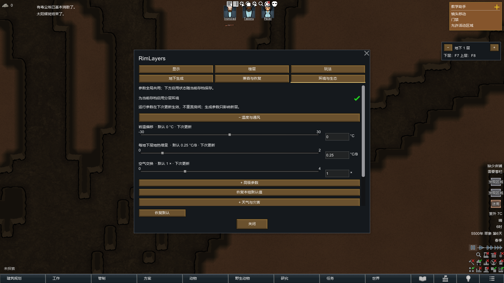
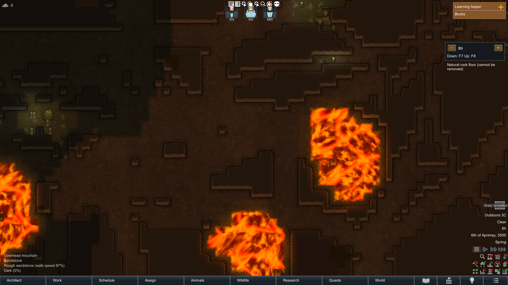

# 分层环境、地下生态与矿物

## 如何启用

安装新 DLL 后重启游戏。在 **模组设置 → RimLayers → 环境与生态** 调整参数。

- 新游戏默认启用分层环境；旧档需要勾选“为当前存档启用分层环境”。
- 数值全局共用，启用状态随存档保存。恢复设置默认值不会改变存档开关。
- 运行参数下次相应更新生效，不重置已有室温、污染、矿石生命值和虫巢进度。
- 矿物、熔岩、初始虫巢参数只影响之后生成的地下层。既有层不重刷。
- 默认地下上限仍为 B2。需要探索默认 B6 起的熔岩时，自行提高楼层额度。
- 关闭环境功能不会删除已有熔岩、矿石或虫巢。已有地形的接触危险和原生冷却仍存在。

六个分类以两行三列显示。环境页分为温度与通风、天气与灾害、矿物、熔岩、虫灾；高级参数可折叠。数值同时支持滑条与输入，显示单位、默认值和生效时机。矿物数量与初始虫巢开关复用原字段。

## 地下不再统一为 15°C

新层岩温初始为当地年均温＋偏移＋每层地热增量，默认增量 0.25°C/B。随后岩温以 `3×深度²` 游戏日的时间常数追随本地外界温度。热浪、寒流、火山冬天和其他原生气温变化仍作用于室外，再经岩体与真实通道传入地下。

岩体可给冷房间供热，也可吸收热房间的热量。墙后是天然岩体时采用岩温，不直接回退到室外。机器、火灾、暖气、冷气、虫巢和熔岩仍按实际位置产生热量。

楼板缓慢导热，开口快速交换；同一次垂直交换使用统一快照。屋顶按该列的真实外包络散热，而非要求房间位于全图最高层。地上默认每层降温 0.02°C，风速乘以 `(1＋层数)^0.2`，仅强化外露边界换热。

## 天气、防护与灾害

天空暴露、侧向风暴露、天然厚岩屏蔽、温度和房间浓度来自共享查询，不全局替换 Roofed、地图室外温度或停电状态。

- 雨雪、沙尘堆积、雨洗、灭火及天气心情使用实际遮挡；毒雨和血雨需要实际接触降水。
- 普通浓雾、毒尘、酸性烟霾、火山灰、灰雾与死亡尘雾按房间体积及开口交换，每 120 tick 更新。默认沉降半衰期一游戏小时。
- 关闭通道停止新输入，残留继续沉降。事件结束后的局部残留仍影响画面、移动、射击和适用的健康／物品效果。
- 毒尘按浓度缩放原生毒伤与植物／物品影响，保留原生抗性和资格。火山灰默认阈值 0.25，死亡尘雾复活候选阈值 0.5；尸体年龄、资格与原生间隔保留。
- 移动使用当前位置；射击精度与浓雾射程使用三维射线的受影响路段。预览、AI 与实际判定沿用相同计算。
- 日食等天空降光不直接削弱封闭地下的人工照明。极光和发光孢子的观赏收益要求天空暴露；诡异黑暗仍按实际光照判断。
- 雷击按逻辑 X/Z 列选择最高暴露承托面，不复制雷击。天空来物继续走既有第一接触面、破顶及内容物保全链。
- 龙卷风只有一个真实实体，沿地表逻辑坐标移动；同风柱打击地上暴露面，地下不受直接风伤。隔离带不能成为跨层通道，地下发生器不能制造地下风柱。
- 洪水和熔岩流沿本层及开放的独立液体通道向下传播，不向上、不穿完整楼板；共享原生前沿预算、退水及冷却。
- 干旱种植惩罚仅作用于对应露天环境；水培等原生豁免保留。鱼鳃腐病保留水体／鱼群范围。
- 精神低语、抚慰、仇恨吟唱及行星毁灭等不因岩层而免疫。

### 太阳耀斑下供电

默认天然厚岩覆盖的独立电网可运行。整网任何接通节点暴露，整网仍受耀斑干扰；断开后必须完成原生电网重建才能恢复屏蔽。人工楼板不能替代天然厚岩。其他停电条件、EMP、损坏、轨道通信与发射限制没有这一豁免。

空气、热和液体具有独立通道权限。未知第三方天气不自动获得原生天气策略；扩展入口为 `LayerEventPolicy.RegisterWeather`、`RegisterAirborne`、`RegisterLiquidEvent`。

## 深挖的收益来自预算与矿种变化

矿簇预算：

```text
逻辑面积 / 10000 × 地下原生密度 × 现有 Minerals 数量倍率
× 适用的游牧资源难度倍率 × min(1.4, 1 + 0.05 × (B - 1))
```

默认 B1／B5／B9 的深度预算系数为 1／1.2／1.4。此加成只改变矿簇预算，不同时放大矿簇尺寸和每格产量。矿簇仍使用原生不规则形状、原生矿石实体和采矿进度。

| 资源 | B1 权重 | B5 权重 | B9 权重 |
|---|---:|---:|---:|
| 钢铁 | 1 | 0.85 | 0.65 |
| 机械／零部件 | 1 | 0.70 | 0.35 |
| 银 | 1 | 1.10 | 1.40 |
| 金 | 1 | 1.40 | 2.40 |
| 铀 | 1 | 1.60 | 3 |
| 塑钢 | 1 | 1.50 | 3 |
| 玉石 | 1 | 1.20 | 1.60 |

层间线性插值后再归一化选择；没有稀有矿保底。自然矿带按地图种子、矿种、宿主岩体与深度确定，相邻层缓慢偏移，不复制上一层矿格。

熔岩外侧 4–12 格的地热候选带重新分配同一预算内的矿簇：银／金默认最高 2×、铀／玉最高 1.5×；工业遗存没有地热加成。Odyssey 黑曜石是明确登记的冷凝带候选，也消耗相同预算。先洞穴／熔岩掩码，再矿物，最后虫巢。

未知 Mod 矿物默认深度倍率 1；仅允许原本可自然散布且产物合法的矿物。单矿种权重 0 排除该矿种，不能启用原本禁用散布的资源。可选扩展：

```xml
<li Class="RimLayers.Underground.MineralDepthExtension">
  <industrial>false</industrial>
  <b5>1.2</b5><b9>1.8</b9><geothermalMaximum>1.5</geothermalMaximum>
  <hostRocks><li>Granite</li></hostRocks>
</li>
```

地下 Mineable 不另登记成重复深钻资源。统计记录预算、实际矿簇数、矿石格数、预计产出与价值；权重不是产量倍数。

## 熔岩与虫巢

普通地区默认 B6、火山地区 B3 起，覆盖率从 0.5% 起逐层翻倍，封顶 4%；局部核心目标 24–96 格，配冷却岸与承顶岩柱。出口及必要施工列保留至少 8 格保护距离。天然深熔岩持续存在，不自行启动全图熔岩流。

稳定 Def 为 `RL_LavaDeep`、`RL_LavaShallow`、`RL_CooledLava`。Core 提供原创基础纹理与原生热害，Odyssey 接入其着色表现，不叠加第二次伤害。深熔岩不可通行，默认 heatPerTick 0.25、引燃半径 1.9；浅熔岩保留原生烧伤并使用原生临时地形队列冷却为冷却岩。加热倍率 0 只停热输入，不免除接触烧伤。

首次生成的探索虫巢默认每约 1000 格适生候选洞穴抽取一次，保留有限初始虫群，但不持续产虫或扩巢。遵守难度、派系、剧本和原有开关，避开熔岩、危险温区和施工入口。开雾、重进地图和重载不刷新。

普通后续虫灾保留原生频率、点数、间隔和全图 30 巢限制，使用实际层温度／光照与同层距离。默认 −17°C 低温边界，50°C 起热抑制，60°C 零分；灯光只降低评分，不保证免疫。同次巢群、子巢和出生点限定同层，活虫仍可走真实通道追击。钻机、废物、任务和遗迹来源保留专属资格。

持续巢产虫／扩巢倍率 0 暂停并保留剩余进度；恢复不重置计时，非零变更在下一次原生计时计算生效。有限探索巢不会因此变为持续巢。

## 参数边界与保存

主要参数默认值和范围可直接在环境页查看。矿物数量 0 不会通过地热另生矿物；地热强度 0 关闭富集；深度差异 0 恢复中性深度权重。覆盖率上限与核心面积上下限联动。读取非法值按各字段自己的默认值恢复。

保存生成版本、种子、完成标记与汇总统计；矿石／虫巢实体继续由原版保存。岩温、活动污染和必要原生暂停计时随档保存，不保存 Room／PowerNet 引用。所有生成步骤位于现有扩容事务中，失败回滚；浅熔岩冷却队列只在事务提交后登记。参数预览不显示迷雾内位置。

## 验证记录

基准：本机 RimWorld **1.7.4984 rev1242**、Waylith／.NET 10、Harmony 3。游戏均使用独立测试数据目录。

- 纯逻辑：222,712 项气候、深度预算、熔岩及浓度守恒检查通过。
- 原生气体：100,000 条默认随机链，另加 40,000 条 0–4× 交换倍率随机链通过。
- 全 DLC 环境：`Tests/Artifacts/v1-environment-20261022-014741`，生成 148、重载 13、旧档模拟 13 项通过。涵盖真实电网隔离、龙卷风风柱、下灌预算、残余毒尘、有限／持续巢、B6 生成故障回滚与原生保存。
- Core 地质与参数边界：`Tests/Artifacts/v1-environment-geology-20261022-014025`，242 项通过，包括未知矿物中性权重、禁用矿物、单矿种全零、价值上限、0／0.5／2× 矿簇与熔岩开关、入口保护、无 Odyssey 原生冷却。
- Core 环境：`Tests/Artifacts/v1-environment-20261022-014228`，生成 133、重载 13、旧档模拟 13 项通过，包含龙卷风精确位置与原生消散计时。
- 全 DLC 地质：`Tests/Artifacts/v1-environment-geology-20261022-013325`，229 项通过；矿石实际实体计数与生成统计一致，B6 起熔岩、覆盖率及掩码正确。
- 默认性能：`Tests/Artifacts/v1-environment-perf-20261022-013445/environment-performance.json`。250×250 五层、20 名原生殖民者，600 tick 预热，ABBA 四组各 1200 tick。关闭／启用均值 **0.9390／0.7894 ms/tick**，此批次未测出超过 5% 的回退。该测量为晴天模拟 CPU，不含生成与渲染，不表示所有事件负载均更快。

完整可分发结果： [原生环境与存读档](Validation/Environment/alldlc-generate.json)、[矿物完整批次](Validation/Environment/mineral-distribution-alldlc.json)、[原始 tick 样本](Validation/Environment/tick-performance.json)。原始隔离存档与日志仍保留在对应 Tests/Artifacts 运行目录。

### 固定种子矿物批次

120×120 逻辑地图，B1／B5／B9 各 20 个固定 RNG 种子，同洞穴／宿主岩体掩码。下表为整个批次的实际规划结果；预计产出采用原生每格产量，未计殖民者技能等采矿修正。完整每种矿物数值在 `mineral-distribution.json`。

| 深度 | 矿簇 | 矿石格 | 预计产出总和 | 基础价值总和 | 金簇占比 | 铀簇占比 | 机械簇占比 |
|---|---:|---:|---:|---:|---:|---:|---:|
| B1 | 280 | 5090 | 182206 | 408188 | 1.07% | 4.29% | 43.21% |
| B5 | 340 | 5922 | 218488 | 540524 | 5.59% | 10.00% | 32.06% |
| B9 | 400 | 6527 | 249414 | 730528 | 8.50% | 18.00% | 17.00% |

### 实机画面

中文六页设置及参数：


B9 局部熔岩、冷却岸、岩柱及探索虫巢：


### 验收范围

已实测原生 Core／全部官方 DLC 的上述组合；第三方矿物验证依据合法池与扩展规则，不等同于逐个创意工坊矿物模组的组合认证。性能结论限定于记录场景。载具合并与安装记录如下。


## 合并版已安装

正常启动（无原型开关）的 Technical Vehicles TC_BigBread 电梯＋扩容回归：

- `Tests/Artifacts/vehicle-ground-20261022-015011`：生成 22、重载 19、恢复重载 7 项全部通过。
- 覆盖真实载具、原生驾驶 Job、扩容故障回滚、轿厢互斥、断电暂停、乘员／货物身份与损伤保存、目的站拆除后的安全恢复。
- DLL／PDB 已更新到 `Mods/RimLayers/Assemblies`。包含当前载具兼容源码及本次环境实现；重启游戏加载。
- 最终候选保留在 `Tests/Artifacts/environment-release-20261022`；恢复 DLL 为其 `recovery/RimLayers.previous.dll`。恢复前关闭游戏，将备份复制回 Assemblies/RimLayers.dll；已有新熔岩地形与新格式状态的存档请保留本次版本。
- 实际安装路径及各项记录见 [installation.json](Validation/Environment/installation.json)。
