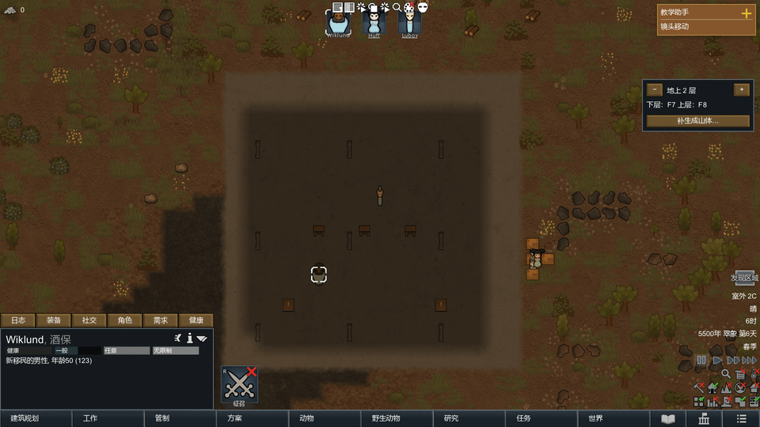

# 换层过渡：实现与验收

## 使用

更新 DLL 后重启游戏。F7/F8、Alt + ↑/↓、右侧 −/+ 和楼梯返层按钮默认播放俯视升降；在 **模组设置 → RimLayers → 显示 → 换层过渡动画** 关闭后恢复瞬切。点击地图下令、拖动或操作相机会立即结束视觉偏移，再交给原版处理输入。



预览来自 `v1-transition-20261021-034703` 原生截图，按 60 fps 组织并缩至 960 宽，首尾各加 0.6 秒停留方便观察；性能数据使用原始计时，不使用预览播放时间。

## 行为与同步契约

- 混合阶段 **320 ms**，用现实时间和 SmoothStep；暂停及游戏倍速不改变曲线。
- 上楼：旧图 100% → 96%、下移 1%；新图 104% → 100%、从上方 1% 落定。下楼反向。中心缩放，UV Clamp。
- 新层是不透明底图，旧图透明度 1 → 0；只有场景纹理变化，真实相机不在存储带之间插值。结束保持逻辑 X/Z 与原缩放。
- `LayerView.Switch` / `SwitchRelative` 仍同步返回；手动 UI 使用独立 `LayerTransition.Request/RequestRelative`。自动定位、选中对象跳层和原生 CameraJumper 不等待动画。
- 连续请求以最新目标为相对基准，下一次从当前合成画面开始；方向按物理 Elevation，不按 LayerId。B1 在上层之后追加的夹具验证了这一点。
- 工具栏、殖民者栏、楼层面板和窗口保持原生绘制；楼层名称随实际切换更新。地图附着标签与楼梯返层标签在混合期间隐藏，结束恢复。
- 世界视图、离开当前地图、游戏实例变化、分辨率变化、原生飞船过场/捕获状态会取消；关闭设置或地图输入完成已接受的目标并释放纹理。捕获异常回退同步切层，WarningOnce 记录。
- 动画不写入存档。最多持有三张屏幕尺寸颜色 RT，连续转向交换缓冲；空闲不捕获。资源来自临时纹理池，结束归还池并清除私有材质引用。

## 渲染接入

`Presentation/LayerTransition.cs` 在宿主 `MapRenderFeature.CaptureFrame` 后借用完整 `MeshDrawFrame.Draws + PersistentDraws`，使用禁用自动渲染的独立 Camera 和原生 `CameraTextureBaker.RenderItems` 捕获地图。保留背景和太阳方向；借用的绘制项不销毁、不更改。

双图合成使用同一独立 Camera 的显式 Render、受限 camera callback、两个私有 Transparent 材质及即时平面绘制。原生 Camera.Render 单独复制 pending commands 会遗漏持久 Section 光照，不能作为完整地图捕获。生产路径没有 ScreenCapture、ReadPixels、CPU 图片转换或图片落盘；诊断场景显式导出带 UI 的 PNG 供验收。

证据与成员入口见根目录 [渲染文档](../../../docs/assets-localization.md) 和 [sources](../../../docs/sources.md)。当前基准：RimWorld **1.7.4982 rev1280 / Waylith / .NET 10**，Assembly-CSharp MVID `484efdc5765b463ca9cc54a6131e38f0`。

## 构建、数学检查、实机检查分开记录

- Release 构建：0 警告、0 错误，输出 `Assemblies/RimLayers.dll`。
- `Tests/TransitionTests`：857 项通过，覆盖双向端点、单调淡出、中心 UV、缩放比例、位移幅度和物理高度方向。已接入 Run-V1 的 `-CheckPure`。
- 以下均为重启原生游戏的独立测试配置，仅启用 Core、Harmony、RimLayers；未修改玩家存档、启用列表或配置。

| 运行目录（Tests/Artifacts/ 下） | 实际画面 | 结果 |
|---|---|---|
| v1-transition-20261021-033743 | 1920×1080 / 100% | 新建 110、重载 109 全通过；完整帧捕获修复后的首轮 |
| v1-transition-20261021-034703 | 1920×1080 / 125%，简中 | 新建 128、重载 127 全通过 |
| v1-transition-20261021-035557 | 1280×800 / 100%，英文 | 新建 134、重载 133 全通过；含取消、故障回退及炮台瞄准 |
| v1-transition-20261021-040235 | 1280×800 / 100%，英文 | 新建 143、重载 142 全通过；最终专项，含真实窗口缩放取消及故障注入 |
| v1-settings-ui-20261021-035756 | 1920×1080 / 125%，简中 | 10 项通过；已查看新增开关的实际设置页 |
| v1-command-input-20261021-035821 | 原生默认窗口，英文 | 18 项通过；原版移动、跨三层走路、右键射击、攻击指令与下层目标 |

实机断言覆盖：
- 地表↔上层、地表↔后追加的地下层；跨多层、连续请求、快速反向、同层、无效目标。
- 暂停、Normal 和 Superfast；记录的 simulation ticks 在暂停为 0、非暂停真实推进。
- 地图四角，原版最小/最大缩放，逻辑 X/Z 与缩放保持，Pawn 选择保持。
- 原版 UIRoot 的 F7/F8、Alt 方向键；原版楼层面板及楼梯返层控件。
- 混合时右键提交实际跨层 Goto；自动 CameraJumper；炮台保持选中和原生 Verb 瞄准来源；关闭动画恢复同步入口。
- 真实窗口从 1280×800 切至 1024×768 时取消并归还 RT，恢复原尺寸后继续正常手动导航；世界渲染模式、当前地图离开、原生 cutscene 标志取消；捕获函数注入异常后实际执行同步回退并清空 RT。
- 每段过渡结束纹理归还，静止期间 SceneCaptures 不增加；重载不带回动画状态。

**额外旧套件结果：** `v1-usability-20261021-040352` 为 18 项中 15 通过、3 失败，errors=[]。关闭动画后的原生 F8/F7、Pawn/Job 保持、背景目标、施工检查通过；失败仅为 `native-new-arrival-has-safe-surface`、`generic-invalid-new-spawn-is-repaired-with-same-pawn`、`recovery-preserves-nanami-instance-and-safe-surface`。这些断言紧跟 Spawn / SpawnSafety.Recover 要求即时复位；现有 EntityRecoveryService.Notice 设置 NextAttempt=tick+1，SpawnSafety.Recover 仅 QueueMap。前两项甚至在本场景首次切层前执行。该历史夹具需要由恢复测试维护工作改为等待原生队列完成；本次未修改恢复逻辑或放宽其断言，不能将整个 usability 套件记为通过。

飞船边界使用原生 cutscene 标志测试取消，未在本次重录完整飞船起降。第三方自定义渲染器、其他 GPU/驱动未纳入这组结果。

## 逐帧画面与性能

已检查上楼/下楼、地下出入、快速转向和远近角落截图：没有黑闪、UI 交叉淡入、存储带穿帮或结束缩放跳变；完整帧捕获保留屋顶光照、下层投影与雾。实时目标捕获在正常/加速模拟中持续刷新 Pawn/动物位置。PNG 序列前缀 `generate-transition-{case}-` / `load-transition-{case}-`；case 0/1 为地表与上层，2/3 为地下往返，4/6 为连续与反向，8–11 为四角。

计时文件为每轮的 `*-transition-timing.json`。CPU 捕获耗时是同步后端调用墙钟时间；帧间隔包含诊断记录和 PNG 导出开销，不等同于 GPU timestamp。

| 条件 | 捕获调用中位数 / P95 / 最大值 | 更新帧间隔中位数 / P95 / 最大值 |
|---|---|---|
| 1920×1080，125%，新建 034703 | 2.82 / 6.78 / 84.93 ms | 该轮仅记录每次总耗时/帧数 |
| 1920×1080，125%，重载 034703 | 2.55 / 5.88 / 13.99 ms | 同上 |
| 1280×800，100%，新建 035557 | 2.40 / 6.40 / 19.61 ms | 17.00 / 23.57 / 173.07 ms |
| 1280×800，100%，重载 035557 | 2.59 / 6.34 / 16.40 ms | 17.00 / 21.54 / 60.48 ms |

320 ms 指取得目标帧后的混合阶段。加上等待旧层/目标层提交及下一次更新，稳定单次请求到观察完成通常约 **360–390 ms**；首轮冷捕获或新场景准备会更长，035557 首次进入地下为 522 ms。早期独立配置中出现过 551–851 ms 的单次捕获尖峰；最终两分辨率记录仍保留冷启动峰值，不把曲线时长当作端到端延迟保证。连续改向会重启当前 320 ms 混合，不排队逐层播放。

## 保留的失败与修正

- 033410：显式 Camera.Render 丢失持久光照，画面结束变暗；改为完整帧捕获。该轮近缩放测试还用了低于原版下限的 8，已改为原版 sizeRange.min。
- 034253：窗口化 1920×1080 被桌面限制成 1920×1061；测试改用原生全屏请求。注入 Alt 仅写 modifiers 不会设置独立 Event.alt，已修正输入夹具。
- 034253/034442：原版鼠标 UI 坐标底/顶部原点不同，且初始目标落在楼梯上；改为一致原生投影和空闲楼面。
- 035031：炮台夹具在查看其他层时先选中，原版未建立预期选择；改为先切炮台层再选中、开始瞄准。
- 035235/035419：小窗口的合成鼠标与后端裁剪输入不一致，后一次实际落点正确但未提交 Job；保留该反例并增加 Event.Use 原生处理栈及完整状态记录。035557 新建/重载均由 Selector.HandleMapClicks 消费事件并提交预期 Goto。该测试保留精确 Job/目标断言，没有改为仅检测“事件被消费”。

- 035929：真实缩放取消检查通过，但夹具在恢复分辨率的同帧立即排入捕获异常测试；随后的分辨率变化按设计先取消了该请求。最终夹具等待原尺寸和稳定间隔后再注入，040235 新建/重载全部通过。

## 复现

在游戏根目录执行：

```powershell
dotnet build Mods/RimLayers/Source/RimLayers/RimLayers.csproj -c Release
dotnet run --project Mods/RimLayers/Tests/TransitionTests/TransitionTests.csproj -c Release
./Mods/RimLayers/Tests/Run-V1.ps1 -Scenario transition -Language ChineseSimplified -ScreenWidth 1920 -ScreenHeight 1080 -UiScale 1.25
./Mods/RimLayers/Tests/Run-V1.ps1 -Scenario transition -Language English -ScreenWidth 1280 -ScreenHeight 800 -UiScale 1
```

每轮创建独立的 Tests/Artifacts 配置和存档目录，启动 generate，再完整重启执行 load。截图与诊断只在命令行显式启用测试场景时运行。
