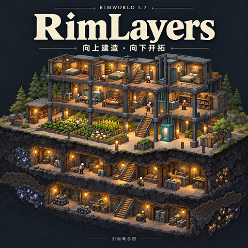
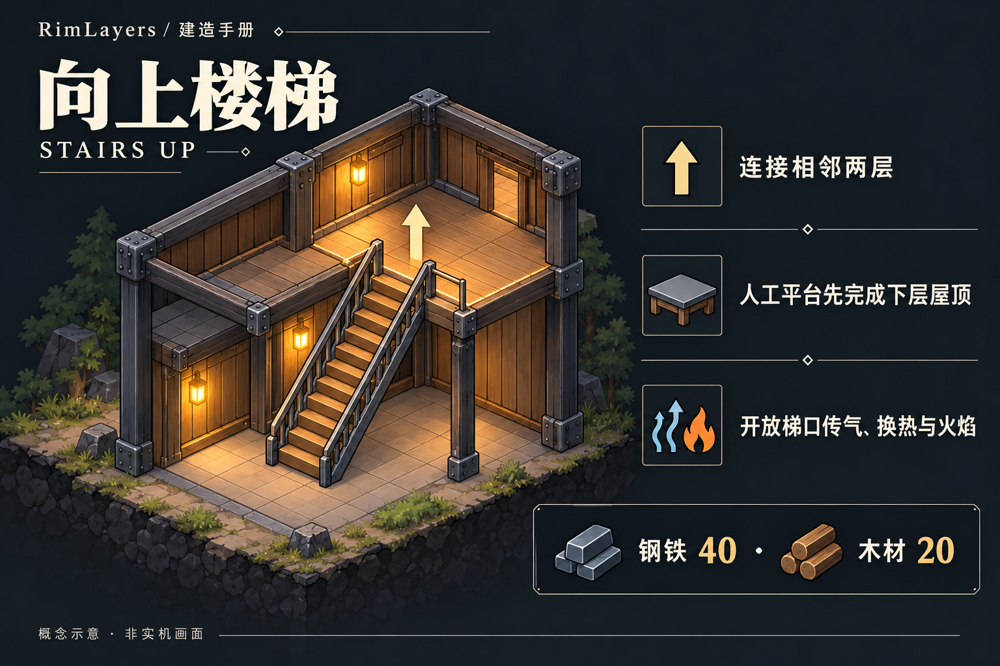
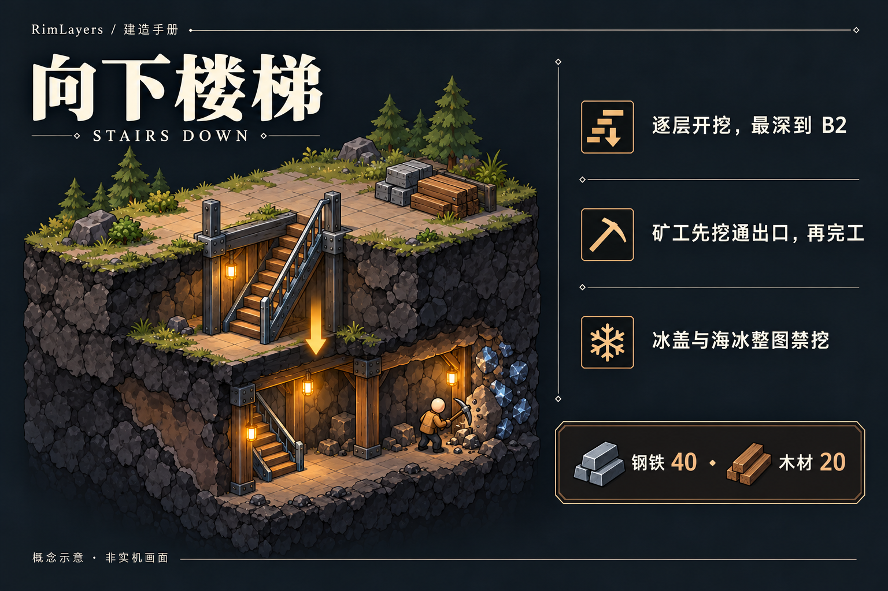
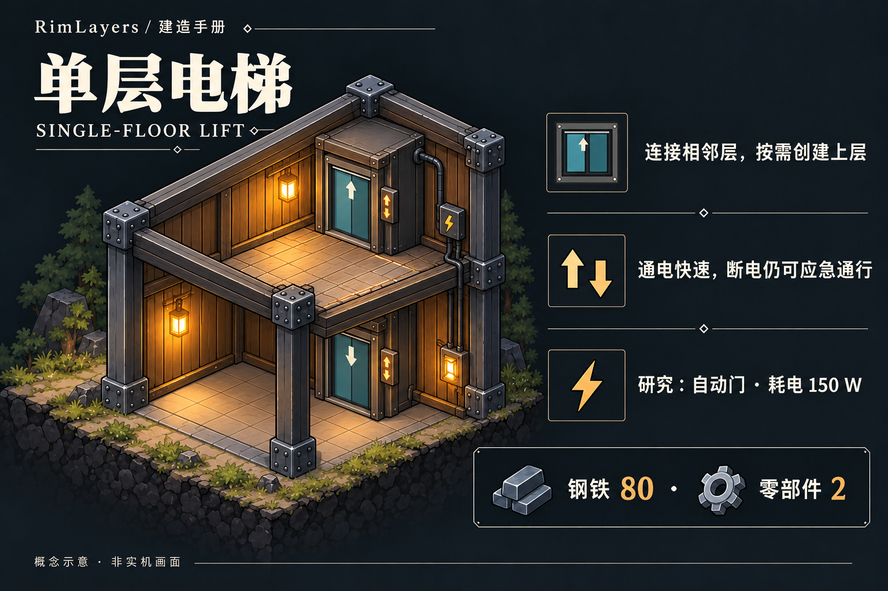
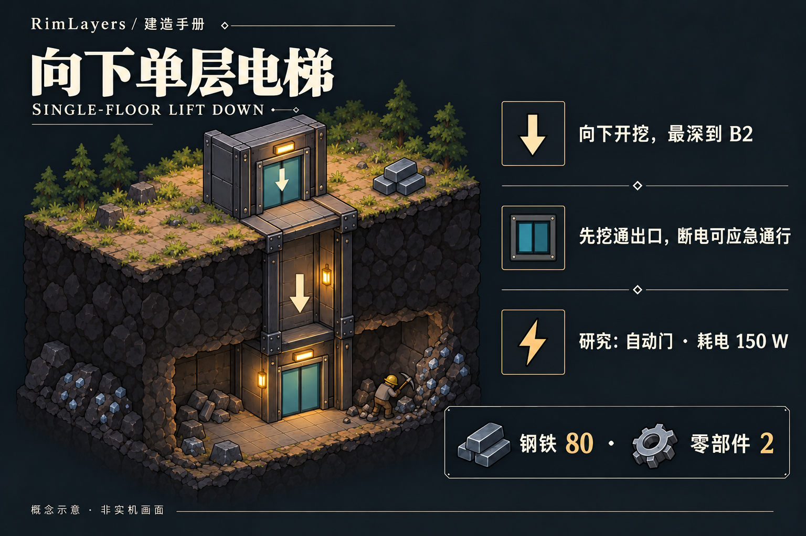
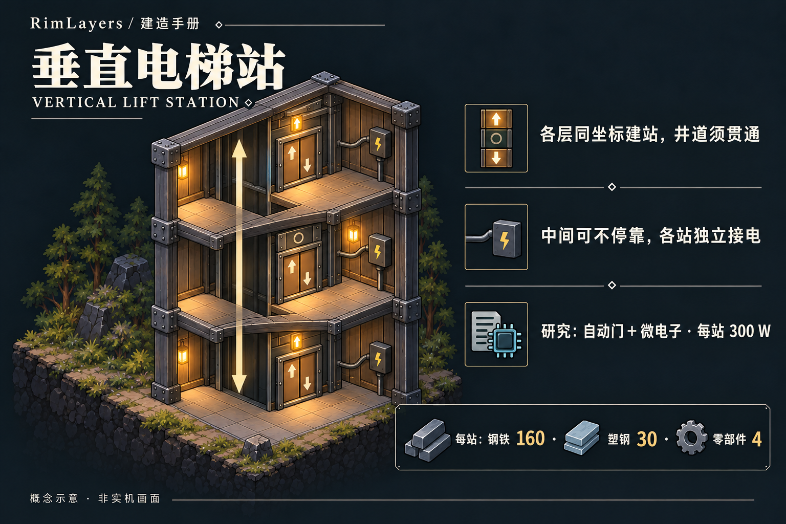
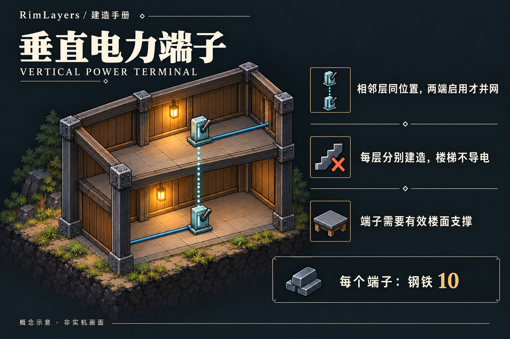
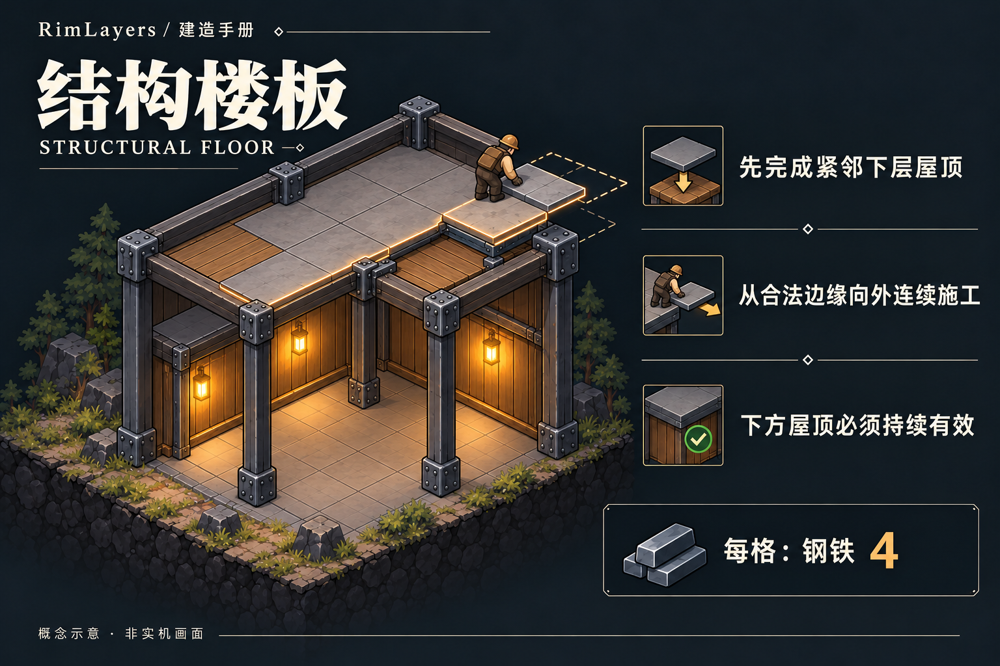
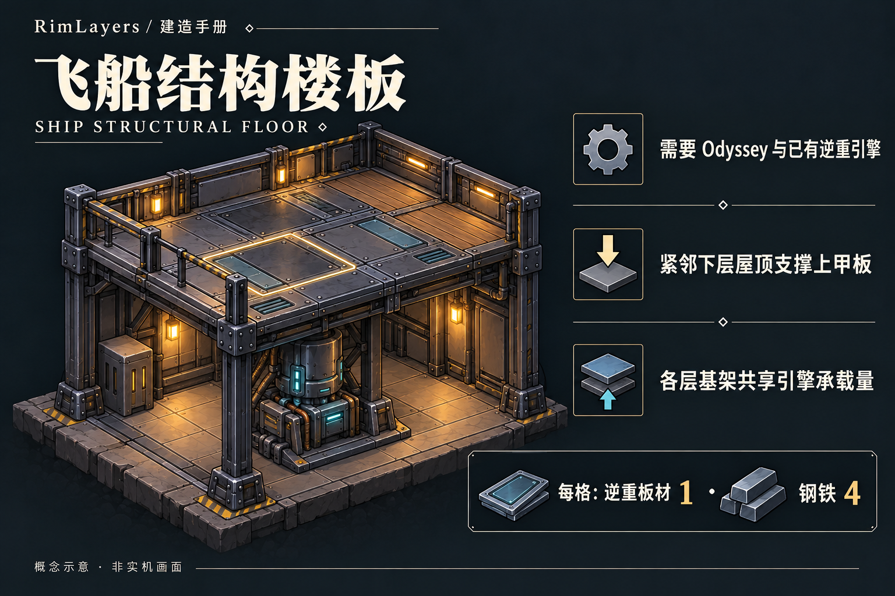

# RimLayers
## 向上建造，向下开拓

把卧室搬到工坊楼上，把矿道开到殖民地下方。**RimLayers 为 RimWorld 1.7 带来同一张地图内的多层殖民地**：地表与按需增建的地上、地下楼层。默认允许地上、地下各 2 层，可在设置中调整。殖民者沿真实连接通行，继续搬运、取料、生产和战斗。

**当前版本：0.1.5 开发候选 · 依赖：Harmony 3 · 语言：简体中文 / English**

[开始建造](#开始建造) · [建筑与楼板](#建筑与楼板) · [安装与存档](#安装与存档) · [兼容与验证](#兼容与验证)

## 一座殖民地，多层空间

- **往上盖，而不是另开一张地图。** 用楼梯和电梯连接楼层，在下层屋顶上铺结构楼板，把工坊、仓库和居住区分层安排。
- **山体也有纵深。** 厚顶岩上方生成天然岩石楼面与独立矿脉；从山侧平台进入，或让矿工先挖通楼梯出口。
- **往下挖，逐层开拓。** 地下有岩层、矿脉、洞穴，也可能遇到虫巢。探索后的合格区域仍可能发生原版虫灾。
- **高低差进入战斗。** 支持跨层射击、原版射位 AI、炮台、护盾、曲射与三维爆炸。楼板、屋顶和墙体会真正挡住弹道。
- **楼层之间会相互影响。** 开放通道可以传气、换热、传声与蔓延火焰；垂直电力端子连接相邻层电网。
- **有 Odyssey，还能造多层逆重飞船。** 多层甲板、乘员、货物与设施随同一艘船航行，普通平台与船体保持各自归属。

封面与下方卡片为 AI 生成的概念示意。游戏使用俯视切层显示；实机画面和各功能的运行记录见[兼容与验证](#兼容与验证)。

## 开始建造

### 先搭一间楼上的房间

1. **在下层完成屋顶。** 人工平台需要紧邻下层的有效人工屋顶或薄岩屋顶；先用墙或柱子把屋顶支撑好。
2. 在“结构”中建造 **向上楼梯**。完工时只追加需要的上一层，并建立最小落脚平台；新地图不会一开始就生成所有空层。
3. 按 **F8** 查看上层，选择 **结构楼板**，沿绿色可规划边界拖出蓝图。工人会从真实边缘逐步铺设，不必每建一圈重新下蓝图。
4. 在有效楼面上正常建房、放家具和下达工作。需要跨层供电时，在相邻层同一位置分别建造 **垂直电力端子**。
5. 想继续向上，在已有上层重复上述步骤。默认允许地表以上 2 层；需要更多楼层时，在“模组设置 → RimLayers → 楼层”中调整单图和全局额度。

**F7 向下、F8 向上**；右侧 `− / +` 和 `Alt + ↑ / ↓` 也可切层，可在“选项 → 按键”中重绑。切换查看层不搬动殖民者，也不重新分派工作。普通点选和建造作用于当前查看层；有屋顶的下层室内不会被透视揭开。

手动换层默认播放 **320 毫秒俯视升降与淡入**，界面保持静止。连续按键直接更新目标；点击地图下令或操作相机会立即结束过渡。可在“模组设置 → RimLayers → 显示”关闭“换层过渡动画”，恢复瞬切。选中对象定位与自动相机跳转仍即时完成。

人工楼板下的屋顶必须持续有效；移除支撑可能引发坍塌。厚顶岩上方的天然楼面走[山体开挖流程](Docs/MOUNTAINS.md)，不能当普通楼板拆除。

### 再开一条地下矿道

在地表合法基底上建造 **向下楼梯** 或 **向下单层电梯**。如果出口有岩石，框架会显示“等待竖向开采”：启用殖民者的采矿工作，先挖通真实岩体，再由建筑工完工。到 B1 后可在地下上限内继续开挖；挖矿进度、产物和矿脉状态随存档保留。

**冰盖和海冰整图禁挖。** 水、冰、熔岩、桥面、基架及悬空位置不能作为入口，装修地板不能改变基底资格。地上楼层、太空与原生独立地下 / Pocket 地图不适用这套向下开挖。详见[地下层指南](Docs/UNDERGROUND.md)。

## 建筑与楼板

便宜的日常通路先用楼梯；需要封闭连接和快速通行时用单层电梯；已有多层、需要贯通直达时再布置垂直电梯站。电梯不自动跨层并网，也不作为传气、换热或明火通道。

以下覆盖本 mod 的 **6 种可建造建筑与 2 种楼板**。卡片展示默认设置的材料、工时、耗电与楼层范围；修改倍率或扩层上限后，以游戏内当前定义为准。

### 向上楼梯

无需电力和研究。禁止殖民者使用楼梯不会封闭通道；关闭落脚门才封闭该通道。未牵引的放牧动物不能自行使用楼梯，牵引时可以通过。楼梯本身不导电。

### 向下楼梯

从地表或 B1 向下开挖。出口未清理时材料留在框架中；拆掉入口不会删除已经生成的地下层，也不会刷新资源。

### 单层电梯

需要建造技能 6。通电通行耗时 25 tick，断电应急为 180 tick；与楼梯一样只追加所需的上一层，连接建立后可双向通行。

### 向下单层电梯

需要建造技能 6。挖掘限制与向下楼梯相同，通行耗时与单层电梯相同；成品安装也不会免费清除出口岩石。

### 垂直电梯站

需要建造技能 6。在**已有楼层**逐层建站，不自动生成楼层或整条井道。中间构件可关闭“本站停靠”，但不能拆掉贯通构件。通电耗时为 `30 + 45 × 层差` tick，应急为 `90 + 120 × 层差` tick；不模拟共享轿厢调度。

### 垂直电力端子

每层分别接入本层电网。关闭端子会同时切断竖向连接与该格本层输电；不要用楼梯或电梯代替它。

### 结构楼板

上面可以铺装修地板、摆放建筑。人工楼面的整个占地都要有合法支撑；屋顶的背景图像本身不是可走楼面。

### 飞船结构楼板 · Odyssey

用于**已有引擎船体的上甲板**，可叠加装修。要在二、三层起造船底，先建普通结构平台，再铺原版逆重飞船基架并安装引擎；普通楼板不会自动变成飞船甲板。

## 多层飞船怎么用

需要 **Odyssey**。引擎可以位于任意甲板，驾驶台、推进器、延展器和油箱可跨层关联；各层基架共同消耗承载量，原版研究、燃料、冷却和设施上限继续生效。

- 可选择已有上层作为落点，船底落在选定层，引擎保留相对高度；**载荷最多跨 6 层甲板，最高点不能超过海拔 +9，新增层还须通过配额检查**。高层落点仍需合法下层屋顶支撑，起降通道必须净空，地下不能起降。
- 船底可以覆盖普通停机坪，离开后还原平台及装修。相邻的船保持独立身份，普通建筑不因贴着船就自动归船。
- **跨越起飞移动边界的建筑会在确认后销毁**，其真实容器内容与框架材料留岸；跨界区域应先拆分。
- 旧通用甲板需在引擎上使用“转换旧甲板”预览并确认。原版逆重锚政策不变，**无锚强行起飞仍会放弃原地图**。

详细操作见[飞船与普通楼层共存](Docs/SHIP-COLONY-COEXISTENCE.md)及[多层飞船与电梯](Docs/DECKS-AND-ELEVATORS.md)。

## 战斗与环境要记住的事

选中射手并进入原版攻击模式，再切到目标楼层。楼板、屋顶和墙会影响射线；能看见下层背景不代表能射穿它。人物与炮台使用跨层射击解，普通近战仍限同层。迫击炮即使攻击同层目标，也会检查上方空间。具体射程、掩体和灾害规则见[三维战斗指南](Docs/COMBAT-3D.md)。

跳跃背包和蝗虫装甲可通过原版“跳跃”命令跨层：进入选点后切到目标层。可沿平台边缘上下跳，但不能穿过天花板、楼板、飞船甲板或地表进入地下；高度差计入射程。详见[跳跃背包指南](Docs/JUMP-PACK.md)与[游戏验收](Docs/JUMP-VALIDATION.md)。

完整楼板阻气，开放井口与楼梯通道按各自授权传气、换热、传声和蔓延火焰。天空暴露按整列楼板与屋顶判断；人工灯光当前限同层。地下边缘不是世界出口，天空投送不会落到地下。

## 设置与异常恢复

从“模组设置 → RimLayers”打开 **显示、楼层、玩法、地下生成、兼容与恢复** 五页。设置全局共用；界面标明即时生效、重启生效和仅新生成层生效的项目。

单图上、下限默认各 2，全局额外楼层默认 20；例如上、下限各 5 可容纳地表加上下共 11 层。降低上限不删除旧层，也不阻断已有通行。空层仍占配额，只有地图真正移除才释放。

遇到异常空域实体时，默认先寻找下落承托，再安全复位；没有合法落点就暂存原对象。打开“兼容与恢复 → 待恢复列表”定位、重试或指定合法落点。兼容恢复不附加伤害，正常坍塌仍按每层 8 点钝伤结算。来源地图已移除时，恢复到其他地图需要明确确认。

[完整设置与恢复说明 / English guide](Docs/SETTINGS.md)。超出旧版 ±2 范围的楼层存档不能回退旧版 DLL 读取。

## 安装与存档

1. 使用 **RimWorld 1.7**。加载顺序为 **Harmony → RimLayers**，使用匹配 1.7 的 **Harmony 3**；基础楼层玩法不要求 DLC，飞船功能需要 Odyssey。
2. 本地安装时将完整 mod 文件夹放到 `RimWorld/Mods/RimLayers/`，在模组列表启用后重启游戏。当前核对基准为 **1.7.4982 rev1280 / Waylith / .NET 10**。
3. 旧地图可在首次建成连接器后按需扩层，不会仅因读档就自动增加楼层。**先备份原存档，首次使用后另存新槽。**
4. **使用了楼层的存档持续依赖 RimLayers，不能安全移除。** 更新 DLL 后必须重启游戏，Def 热重载不能替代重启。

建议地表尺寸不超过 **250 × 250**。首次追加楼层会暂停片刻，地图越大耗时越高；长期大型殖民地与大型战斗的性能仍需更多验证。

## 兼容与验证

- **不要同时启用 IsoRim ProjectZ 或 Baal.SecondFloor。** 它们与本 mod 的楼层实现冲突，元数据已声明互斥。
- **可选兼容 Vanilla Gravship Expanded Chapter 1 / 2。** 装有 VGE 时将 RimLayers 排在两章之后；保留 VGE 单活动引擎、燃料管网及干扰规则。不装 VGE 仍支持原生多船。范围与验证见 [VGE 兼容](Docs/VGE-COMPATIBILITY.md)。
- **CE、其他飞船框架、非投射物特殊 Verb 及其他自定义战斗 / 地质框架需要单独适配。**
- 原生独立地下地图与 PocketMap 不自动扩层。普通 NPC / 太空地图也不自动扩层；合法入站飞船准备和主动建成连接器按各自规则处理。
- 已有 Core 与全五 DLC 的独立场景记录，覆盖跨层工作、保存重载、结构、山体、地下、战斗及原生飞船；具体组合和结果以各验收文档为准。

实机画面与运行证据：

- [地下 B1/B2、竖向开采与存档](Docs/UNDERGROUND-VALIDATION.md)
- [山体入口、独立矿脉与旧层迁移](Docs/MOUNTAINS.md)
- [射击、炮台、爆炸与跨层灾害](Docs/COMBAT-3D.md) · [真实袭击与投掷](Docs/RAID-COMBAT-VALIDATION.md)
- [飞船停靠高度与普通平台共存](Docs/SHIP-COLONY-VALIDATION.md)
- [换层过渡、输入回归与性能记录](Docs/TRANSITION-VALIDATION.md)
- [俯视切层的实际显示](Docs/DISPLAY-VALIDATION.md) · [跨层连续施工与旧档](Docs/USABILITY-VALIDATION.md)

### 报告问题

请附上游戏版本、RimLayers 版本、启用的 mod 列表、复现步骤，以及问题发生后的 `Player.log`。跨层问题请说明出发层、目标层和连接器类型；存档问题请保留出问题前的存档。

Windows 日志位置：`%USERPROFILE%/AppData/LocalLow/Ludeon Studios/RimWorld by Ludeon Studios/Logs/Player.log`。

## 开发、素材与许可

- 包标识：`rimlayers.core`；程序集：`RimLayers`；编译目标：`net10.0`。
- [开发记录、构建命令与历史验证入口](Docs/DEVELOPMENT.md) · [设计计划](Docs/PLAN.md) · [实施记录](Docs/WORK-LOG.md)
- [封面、卡片与完整生图提示词](Docs/RELEASE-ART.md)
- [第三方许可声明](ThirdPartyNotices.md)：部分生成适配基于 MIT ProjectZ，保留其许可和归属；这不构成对 ProjectZ 的运行依赖。

