# RimLayers
## Build upward. Dig deeper.

English · [简体中文](README.zh-CN.md)

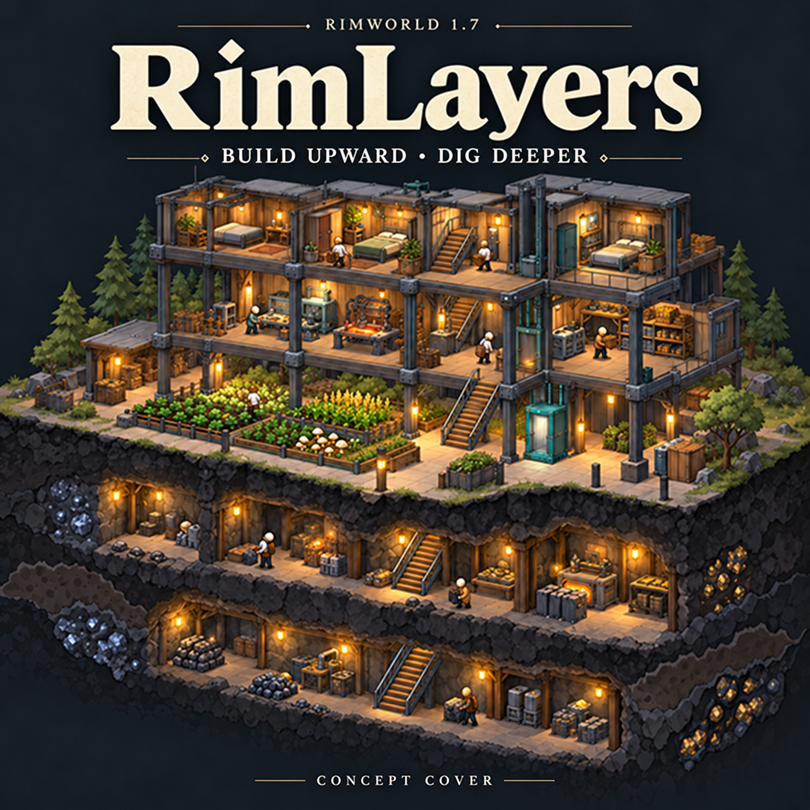

Move bedrooms above the workshop. Open a mine beneath the colony. **RimLayers adds a multi-floor colony to one RimWorld 1.7 Map**, with upper and underground floors created as you need them. The default is two floors above and two below the surface, adjustable in settings. Colonists follow real connections while hauling, gathering ingredients, producing goods and fighting.

**Version: 0.1.5 development candidate · Requires: Harmony 3 · Languages: English / Simplified Chinese**

[Start building](#start-building) · [Buildings and floors](#buildings-and-floors) · [Cargo hoists](#cargo-hoists) · [Vehicles](#vehicles-across-floors) · [Environment](#layered-environments-and-underground-ecology) · [Installation and saves](#installation-and-saves) · [Compatibility](#compatibility-and-validation)

## One colony, more room

- **Build up without opening another Map.** Connect floors with stairs and lifts. Lay structural floors over supported roofs, then separate workshops, storage and living quarters.
- **Send goods upstairs without sending a hauler along.** Manual and electric cargo hoists share stored goods between adjacent floors or along a continuous shaft. Loading, travel and unloading all take time.
- **Mountains have depth, too.** Natural rock floors and independent ore veins form above thick mountain roofs. Enter from a mountainside platform, or have miners clear a stair exit first.
- **Dig deeper for different resources and risks.** Mineral distribution changes with depth and geothermal conditions. Deep magma pockets release heat; finite exploration hives and later expanding infestations have distinct lifecycles.
- **Elevation matters in combat.** Cross-floor shooting supports native firing-position AI, turrets, shields, arcing projectiles and three-dimensional explosions. Floors, roofs and walls really block trajectories.
- **Upper floors face the weather; underground rock buffers temperature.** Open passages carry heat and pollution. Closing them stops new input, while existing pollution settles gradually. An isolated grid entirely beneath thick natural rock can resist solar flares.
- **Vehicles use real connections.** Optional Steel Horizon integration adds full-vehicle ramps, vehicle lifts and three-dimensional flight, preserving the original vehicle, crew, cargo and damage.
- **With Odyssey, build multi-deck gravships.** Decks, passengers, goods and facilities travel together. Colony platforms and ships keep their own ownership.

The cover and feature cards are AI-generated concept illustrations. Gameplay uses a top-down view with floor switching. Actual screenshots and run records are linked under [Compatibility and validation](#compatibility-and-validation). Supporting technical guides are primarily in Simplified Chinese; the settings guide also includes English.

## Start building

### Build your first upstairs room

1. **Finish the roof below.** Artificial platforms need a valid constructed roof or thin rock roof directly underneath. Support that roof with walls or columns first.
2. Under **Structure**, build **stairs up**. Completion creates only the next floor and a small landing. A new Map does not allocate every empty floor in advance.
3. Press **F8** to view the upper floor. Select **structural floor** and drag blueprints along the green planning boundary. Workers build outward from a real edge; you do not need to redraw blueprints after each row.
4. Build rooms, place furniture and assign work on the valid floor. To share power vertically, build a **vertical power terminal** at the same position on each of two adjacent floors.
5. Repeat on an existing upper floor to keep building upward. The default allows two upper floors. For more, adjust the per-map and save-wide limits under **Mod settings → RimLayers → Floors**.

**F7 moves the view down; F8 moves it up.** The right-side `− / +` controls and `Alt + ↑ / ↓` also switch floors. Rebind keys under **Options → Keyboard**. Changing the viewed floor does not move colonists or reassign work. Ordinary selection and building affect the floor you are viewing; roofed rooms below remain hidden.

Manual floor changes use a **320 ms top-down rise/fall and fade** by default, while the interface stays still. Repeated keys update the destination. A map command or camera input ends the transition immediately. Turn off **Floor transition animation** under **Mod settings → RimLayers → Display** for instant switching. Locating a selected object and automatic camera jumps remain immediate.

The roof beneath an artificial floor must stay valid: removing support can cause a collapse. Natural floors above thick mountain roofs follow the [mountain excavation workflow](Docs/MOUNTAINS.md), rather than ordinary floor removal.

### Open your first underground passage

Build **stairs down** or a **single-floor lift down** on valid surface ground. If rock blocks the exit, the frame shows **Waiting for vertical excavation (Mining work)**. Enable a colonist's Mining work: miners clear real rock before builders finish the connector. From B1, continue downward within the underground limit. Mining progress, products and vein state persist in saves.

**Excavation is disabled across ice-sheet and sea-ice Maps.** Water, ice, magma, bridges, foundations and unsupported air cannot be entrances. Decorative flooring does not change the underlying ground's eligibility. This excavation system does not apply from upper floors, in space, or on native independent underground / Pocket Maps. See the [underground guide](Docs/UNDERGROUND.md).

## Buildings and floors

Start with stairs for inexpensive everyday access. Use single-floor lifts for enclosed, fast travel, and vertical lift stations for continuous multi-floor access. Lifts do not bridge power grids or transmit gas, heat or open flames.

The base system provides **six access and power buildings, seven cargo-hoist components and two floor types**. Optional vehicle integration adds its own ramps, lifts and decks; see [Vehicles across floors](#vehicles-across-floors). Cards show default costs, research, power and floor limits. If you change multipliers or expansion limits, use the current in-game values.

### Stairs up

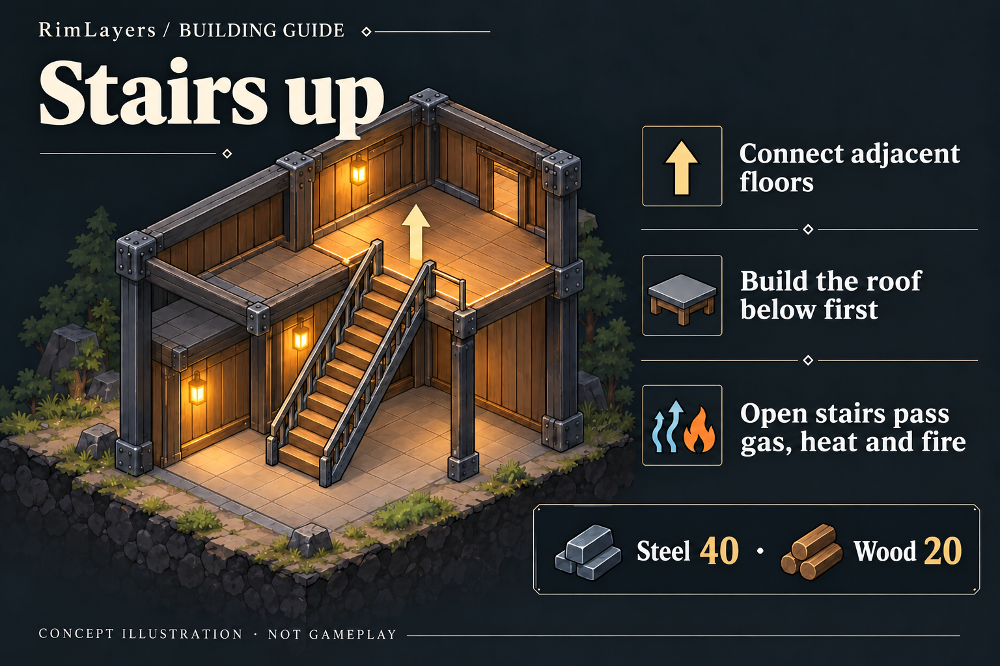

No power or research required. Forbidding stair use does not seal the passage; closing the landing door does. Unroped pen animals cannot use stairs independently, but can pass while being led. Stairs do not conduct electricity.

### Stairs down

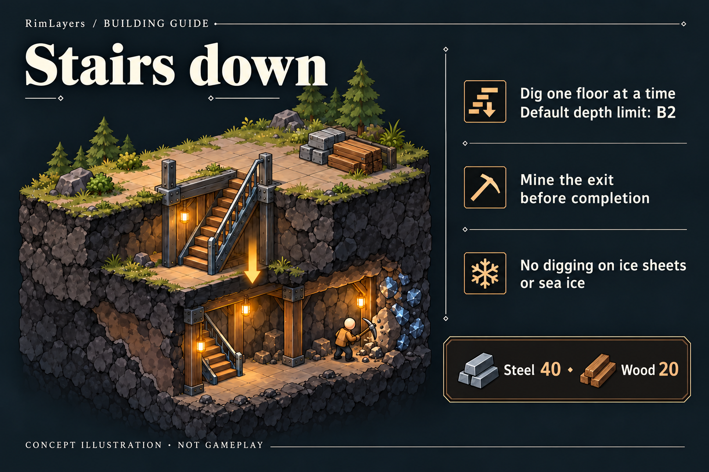

Excavate downward from the surface or an underground floor, within your configured limit. Materials remain in the frame until the exit is clear. Removing the entrance neither deletes generated underground floors nor refreshes their resources.

### Single-floor lift

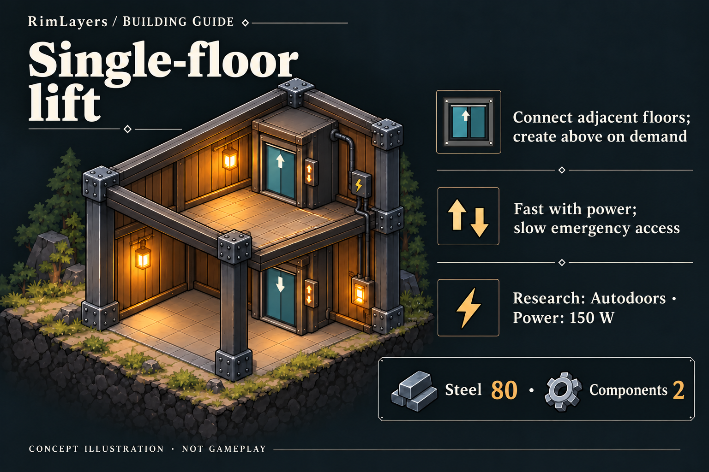

Requires Construction 6. Travel takes **25 ticks with power**, or **180 ticks without power**. Like stairs up, it creates only the next floor when needed. Once connected, access is bidirectional.

### Single-floor lift down

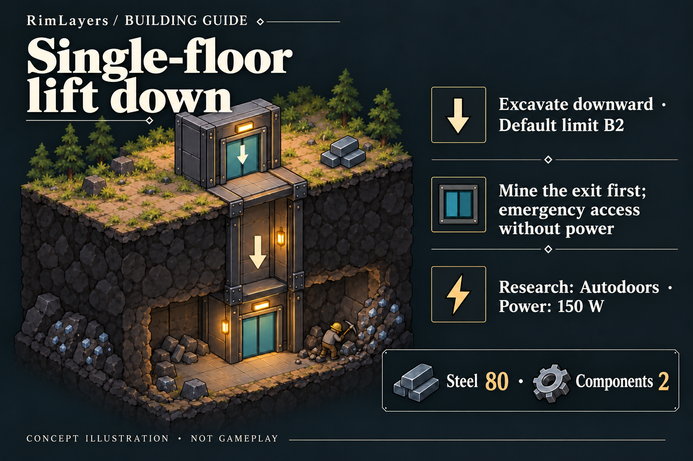

Requires Construction 6. Excavation restrictions match stairs down; travel times match the upward single-floor lift. Installing a finished lift does not clear rock at the exit for free.

### Vertical lift station

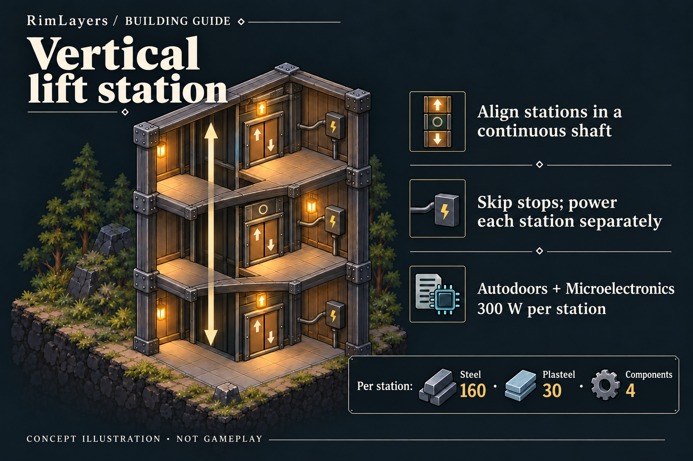

Requires Construction 6, Autodoors and Microelectronics. Build aligned stations on existing floors, or select a completed station and use **Extend shaft upward** / **Excavate shaft downward** to open one adjacent floor at a time. Miners clear real rock at the exit and an adjacent construction position; builders then supply and complete a normally costed station blueprint. Until completion, an enabled source stop provides slow, bidirectional construction access: **210 ticks** at the default emergency-travel multiplier.

Upward and downward extensions can run from the same station. Canceling one direction leaves the other intact; mined rock and generated floors remain. See the [shaft guide](Docs/DECKS-AND-ELEVATORS.md#同一座地面站向上向下扩井) and [in-game shaft validation](Docs/SHAFT-VALIDATION.md).

Keep a component on every intervening floor. Disable a middle stop to retain a through-shaft without entry or exit; removing that component breaks the route. Each station needs its own power connection. Travel takes `30 + 45 × floor difference` ticks with power, or `90 + 120 × floor difference` ticks in emergency mode. Passenger lifts do not simulate shared-cabin scheduling.

### Vertical power terminal

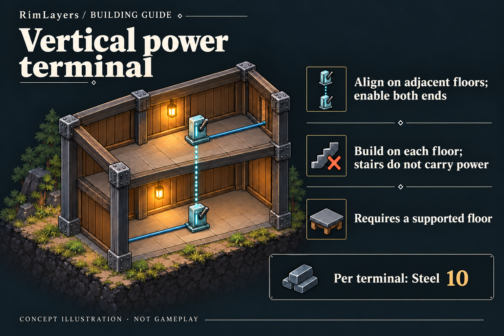

Connect each terminal to its own floor's grid. Turning one off breaks both its vertical connection and local power transmission through that cell. Terminals require valid floor support; stairs and lifts are not substitutes.

### Structural floor

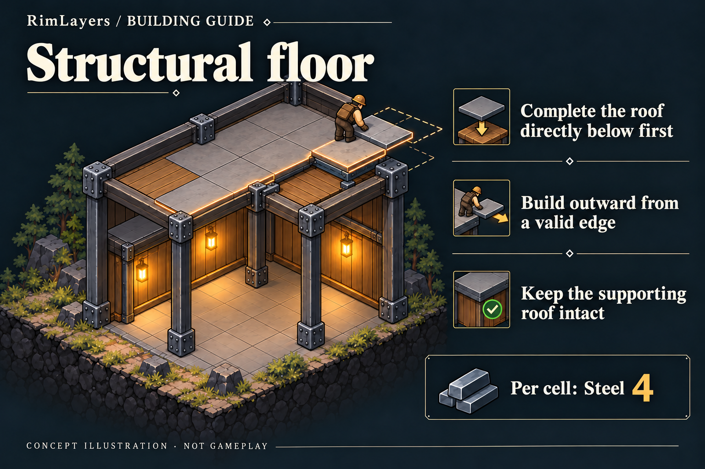

Supports decorative flooring and buildings. The entire footprint of an artificial floor needs valid support. A roof drawn in the background is not a walkable floor.

### Ship structural floor · Odyssey

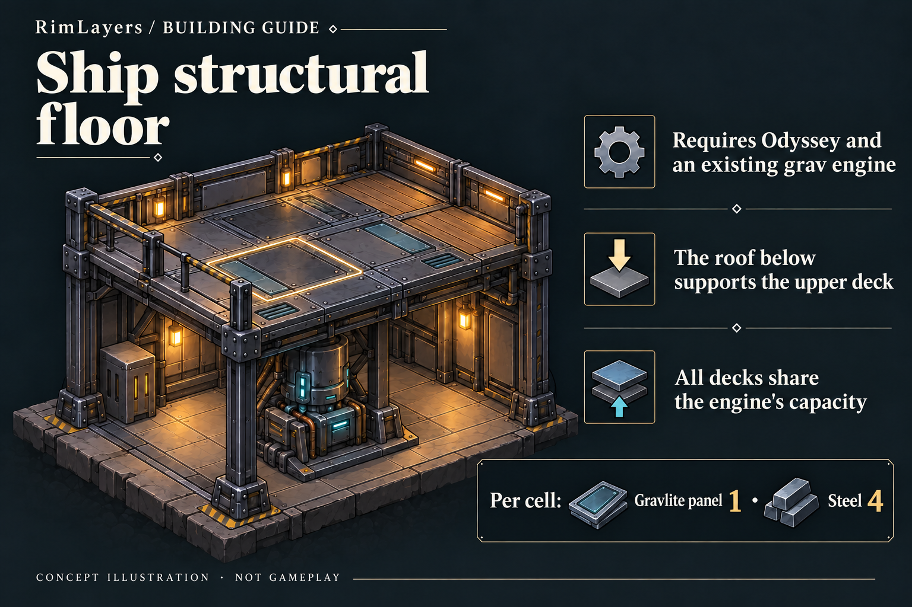

Use this for **upper decks of a ship with an existing engine**. Decorative flooring can go on top. To start a ship's bottom deck upstairs, first build an ordinary supported platform, then lay native gravship substructure and install an engine. Ordinary floors do not automatically become ship decks.

## Cargo hoists

**Store steel in a ground-floor basket, then let an upstairs builder call it for materials.** Hoists move goods already loaded into their physical basket. If it lacks the required item, colonists look for another source normally; the hoist does not collect supplies from distant warehouses.

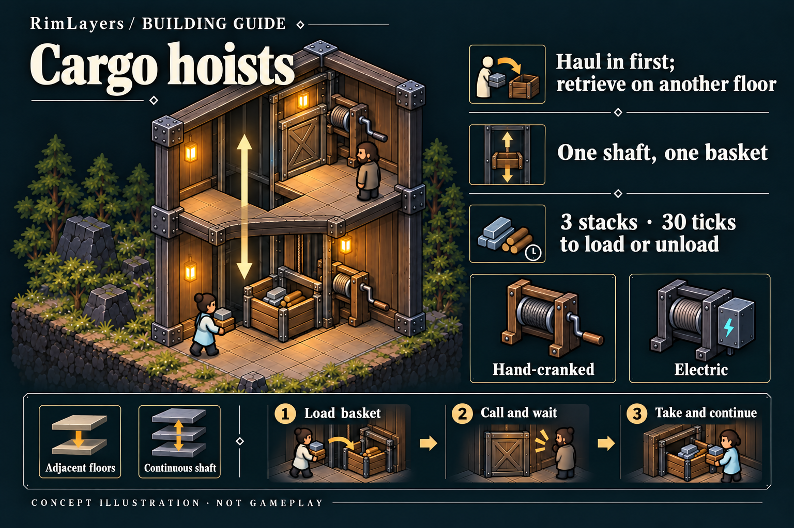

### Set up cross-floor storage in three steps

1. On **existing floors**, open **Furniture → item hoists** or **cargo shafts**. Adjacent-floor hoists offer manual/electric and up/down variants; completing the main unit creates the other port. For a shaft, build the main unit, then add **cargo shaft stations** at the same coordinates on successive adjacent floors.
2. Set filters and priority on any port's **Storage** tab, then let haulers fill the basket or prioritize hauling. All ports share filters and a capacity of **three vanilla stacks**. The default storage priority is **Preferred**.
3. When cooking, crafting, construction or eating requires a stored item, the colonist operates a reachable port, waits, takes the item and resumes the original job. Right-click a port to haul out, wear, equip or eat suitable items. **Call basket here** moves the basket; it does not restock it.

| Variant | Connection | Default materials |
|---|---|---|
| Manual item hoist | Two adjacent floors, up or down | Wood 40 + steel 30, including both ends |
| Electric item hoist | Two adjacent floors, up or down | Steel 90 + components 2, including both ends |
| Manual cargo shaft | Continuous aligned floors | Main unit: wood 60 + steel 60 |
| Electric cargo shaft | Continuous aligned floors | Main unit: steel 140 + components 4 |

Each shaft station costs another **30 steel**, without increasing capacity. Each port occupies **1×1**, with an adjacent interaction cell. Hoists connect only existing floors with valid support: they do not create floors or clear rock. They carry items, not people, and do not connect air, heat or power grids.

**Loading and unloading each take 30 ticks.** For a distance of `d` floors, manual travel takes `180 × d` ticks and requires continuous cranking. Electric travel takes `30 + 45 × d` ticks; the main unit draws **30 W idle / 120 W running**, with colonists still handling loading and unloading. No travel time is needed when the basket is already docked. Manual variants require **Complex furniture**; electric variants also require **Electricity**.

Each shaft has one basket and a first-come, first-served queue. Deposits reserve capacity; withdrawals reserve actual quantities. Interrupted cranking preserves the mechanical position. Canceling electric use lets the current trip finish; power loss pauses travel, while a docked basket remains accessible. The inspect pane shows position, progress, queue and faults. Empty the basket before removing its main unit.

[Full cargo guide](Docs/CARGO.md) · [Job completion, save/load and gravship cargo validation](Docs/CARGO-VALIDATION.md)

## Vehicles across floors

Drive a truck into an upstairs warehouse or park a helicopter on the roof. Optional **Steel Horizon 4.9.2** integration is detected at startup, with no extra switch. Load **Harmony → Steel Horizon → RimLayers**, and place vehicle packs according to their own dependencies.

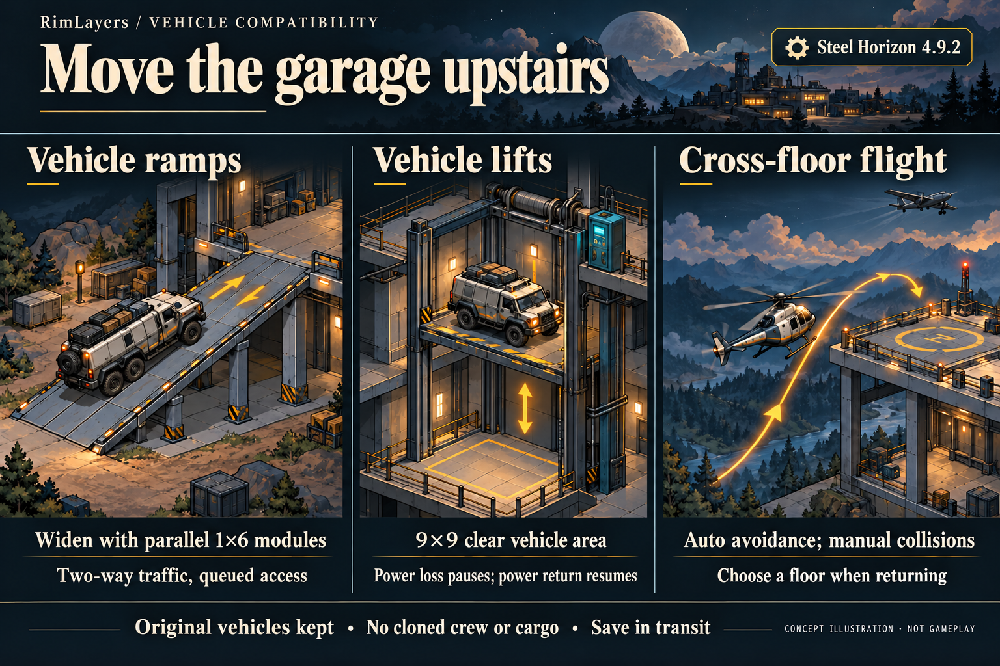

### Ground vehicles use real connections

- **Build ramps wide enough for the whole vehicle.** Each module is one cell wide and six cells long, connecting one adjacent floor. Place modules side by side with the same start and direction. Prepare a supported exit platform and clear overhead space first. Use intermediate landings for multiple floors; do not extend a ramp end to end or turn around on its slope.
- **Lifts carry one stationary vehicle at a time.** Vertically aligned **9×9 clear vehicle areas** form a continuous shaft, with power at every station. A vehicle must be entirely inside and stopped before travel. Opposing traffic queues through corridor reservations. Power loss pauses the lift; power return resumes it. Vehicle lifts do not have passenger lifts' unpowered emergency travel.
- **Automatic tasks and WASD share whole-vehicle checks.** Automatic driving uses the framework's local paths to continue toward the final destination. Manual driving can cross ramps naturally; use **Go to floor** for lifts. Automatic transfers do not force a camera change; manual travel follows the controlled vehicle.

If a station is damaged or a trip canceled, the lift first tries a legal departure station. With no legal exit, it retains the original vehicle. Rebuild the station, clear the full footprint, then recover it from the floor panel. Transfers preserve the vehicle, passengers, goods, fuel and existing damage. Ramp, lift and flight journeys support saving and loading in transit.

### Aircraft cross floors by altitude

- **Keep native driving, takeoff and landing.** Floors are **3 metres apart**. Helicopters, VTOLs and fixed-wing aircraft cross them naturally while climbing or descending; flying above the highest built floor does not create another. Fixed-wing aircraft retain forward-flight dynamics and need approach and turning room; they cannot hover like helicopters.
- **Clearance checks cover the whole aircraft in three dimensions.** Automatic routes avoid obstacles. Manual mistakes, changing obstacles or loss of power can cause real damage and crashes. Solid floors, roofs and walls still block aircraft.
- **Leave from an upper floor and choose a return floor.** Both destination selection and arrival recheck the whole landing footprint and approach airspace. If the landing becomes invalid, the original aircraft stays held by the framework. Choose again through the world vehicle command or the floor panel's waiting-aircraft list; it will not silently divert to the surface.

**Tested vehicles:** Bang Bus and BigBread on the ground; Mosquito helicopter, Toad VTOL and Smuggler fixed-wing aircraft. See the [vehicle guide and actual-vehicle validation](Docs/VEHICLES-IMPLEMENTATION.md) for VVE, VVE Tier 3 and Technical Vehicles load coverage and scenario evidence. Other older vehicles and proprietary components need individual checks.

Enable **one vehicle framework only**. Upstream Vehicle Framework 1.7 still needs adaptation and validation against its actual interfaces. Do not load it alongside Steel Horizon or assume saves can be exchanged between providers. Without a vehicle framework, base floors work normally and vehicle-only facilities remain hidden. This integration does not extend water travel, CE cross-floor combat or all cross-floor vehicle weapon trajectories.

## Multi-deck gravships

Requires **Odyssey**. The engine may sit on any deck. Piloting consoles, thrusters, extenders and fuel tanks can link across decks. Every deck's substructure counts toward the same ship capacity; native research, fuel, cooldown and facility limits still apply.

- Choose an existing upper floor as the destination. The bottom deck lands there, preserving the engine's relative height. **A payload may span at most six decks, with its highest point at elevation +9 or below.** New floors must also fit the quota. Upper landings still need valid roof support directly below, with clear departure and arrival airspace. No underground takeoff or landing.
- A bottom deck can cover an ordinary landing platform; departure restores that platform and its decorative floor. Adjacent ships remain separate, and nearby colony buildings do not automatically belong to a ship.
- **Buildings crossing the departure boundary are destroyed after confirmation.** Their real container contents and frame materials remain ashore. Split boundary-crossing areas before departure.
- For old generic decks, use the engine's **Convert legacy decks** preview and confirm. Native grav-anchor rules remain: **forcing departure without an anchor still abandons the original Map**.

See [ships and colony floors](Docs/SHIP-COLONY-COEXISTENCE.md) and [multi-deck ships and lifts](Docs/DECKS-AND-ELEVATORS.md).

## Combat and open passages

Select a shooter, enter the native attack mode, then switch to the target floor. Floors, roofs and walls affect the firing line: seeing a lower-floor background does not mean you can shoot through it. Pawns and turrets use cross-floor firing solutions; ordinary melee remains on the same floor. Mortars check overhead clearance even against same-floor targets. See the [3D combat guide](Docs/COMBAT-3D.md) for range, cover and hazard rules.

Jump packs and locust armor use the native **Jump** command: enter targeting, then switch to the destination floor. You can jump around platform edges, but not through ceilings, floors, ship decks or the surface into the underground. Height differences count toward range. See the [jump-pack guide](Docs/JUMP-PACK.md) and [in-game validation](Docs/JUMP-VALIDATION.md).

Solid floors block gas. Open shafts and stair passages transmit gas, heat, sound and flames according to each connection's permissions. Sky exposure considers the full column of floors and roofs; artificial lighting currently stays on its own floor. Underground edges are not world exits, and sky deliveries do not land underground.

## Layered environments and underground ecology

Put temperature-sensitive workshops in the rock and leave exposed platforms for outdoor facilities. A shaft is convenient access, but can also bring heat and pollution underground.

**Enabled by default in new saves. For existing saves, enable it under Mod settings → RimLayers → Environment & ecology.** Values are global; the enabled state is saved per game. Running parameters apply at the next relevant update. Mineral, magma and initial-hive generation settings affect new floors only, without refreshing explored resources.

### Weather above, buffered temperatures below

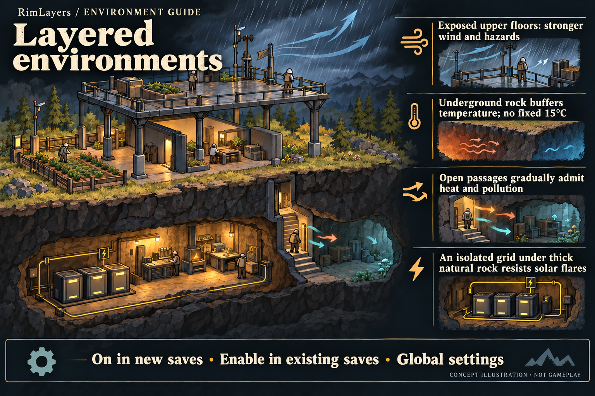

- **Underground temperature is no longer a fixed 15°C.** A new floor starts from the local annual mean, plus **0.25°C per depth level** by default, then slowly follows outside changes. Machinery, fires and magma still heat caves; plan cooling and ventilation.
- **Shelter depends on the actual position.** Floors and roofs block direct precipitation. Lightning first contacts the highest exposed supporting surface in its column. Tornadoes affect exposed above-ground areas; underground areas avoid direct wind damage.
- **Closing a passage stops new input, not existing pollution.** Fog, toxic dust and volcanic ash spread and settle according to room concentration. Movement uses local conditions; accuracy and dense-fog range use the areas crossed by the three-dimensional firing line. Floodwater and lava flows move on the same floor or downward through open liquid passages.
- **Solar-flare protection requires an isolated grid.** By default, every connected node must be shielded by thick natural rock. A single exposed node leaves the whole grid affected. Disconnect it and let the power grid rebuild to restore shielding. Artificial floors cannot replace thick rock; EMP and other outages still apply.

### Deeper resources, geothermal heat and insect hives

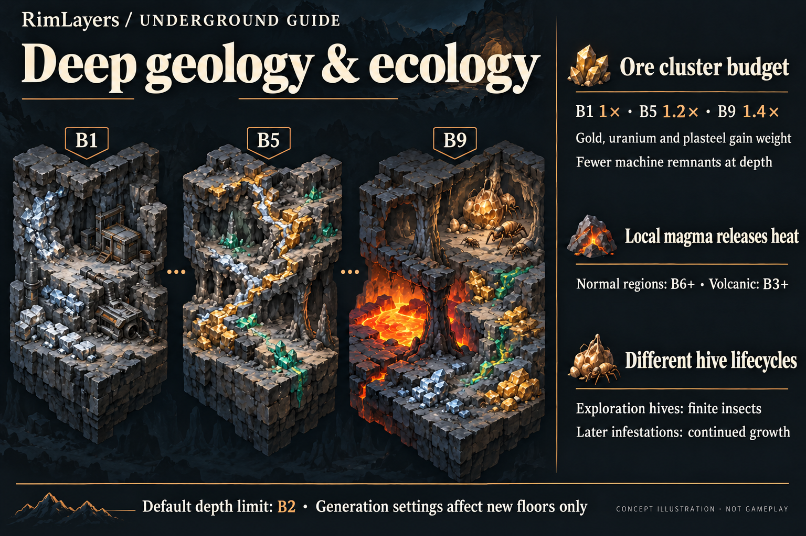

- **Mineral bands favour different resources with depth.** Gold, uranium and plasteel gain relative generation weight; machine remnants become less common. Related seams may shift and branch rather than copy the ore cells above. Depth bonuses change the ore-cluster budget, not yield per mined cell. Rare ores are not guaranteed on every floor.
- **Magma is a local heat source.** By default, it can appear from **B6 in ordinary regions** or **B3 in volcanic regions**, with cooling rock shores and load-bearing rock pillars. Deep magma is impassable; shallow magma burns and can cool. Geothermal enrichment uses the floor's existing mineral budget.
- **Exploration hives differ from later infestations.** Initial hives contain finite insects and do not continually spawn or expand. Later normal infestations retain native frequency, threat points and map-wide hive limits. Temperature and lighting influence placement; live insects can pursue colonists through real connections.

**The default underground limit is still B2.** To dig deeper, raise it on the **Floors** page and leave enough save-wide quota. Changing generation settings does not add ore or magma to existing floors.

[Environment, minerals, magma and infestations](Docs/ENVIRONMENT-IMPLEMENTATION.md) · [Actual B9 screenshot](Docs/Images/Environment/magma-odyssey.png) · [Fixed-seed mineral statistics](Docs/Validation/Environment/mineral-distribution-alldlc.json)

## Settings and recovery

**Mod settings → RimLayers** has six pages: **Display, Floors, Gameplay, Underground, Recovery, and Environment & ecology**. Settings are global; the interface identifies options that apply immediately, require restart or affect newly generated floors only.

The default per-map limits are **two upper and two underground floors**, with **20 extra floors across the save**. For example, five above and five below allow eleven floors including the surface. Lowering a limit preserves existing floors and access. Empty floors still consume quota; removing a Map releases its allocation.

For entities in invalid airspace, automatic recovery first looks for support below, then attempts safe relocation. With no legal destination, the original object stays in suspended storage. Open **Recovery → Pending recovery** to locate it, retry or select a valid position. Compatibility recovery adds no damage; normal collapse still deals **8 blunt damage per fallen floor**. Recovery to another Map requires explicit confirmation if the original Map has been removed.

See the [full settings and recovery guide, including English](Docs/SETTINGS.md). Saves containing floors beyond the old **±2** limits cannot be loaded with an older RimLayers DLL.

## Installation and saves

1. Use **RimWorld 1.7** and its matching **Harmony 3**, loading **Harmony → RimLayers**. The basic floor system needs no DLC; gravships require Odyssey. For vehicle integration, load the vehicle framework before RimLayers.
2. For local installation, put the complete mod folder in `RimWorld/Mods/RimLayers/`, enable it in the mod list and restart. The documented development baseline is **1.7.4984 rev1242 / Waylith / .NET 10**.
3. Existing Maps can expand when you complete their first connector; loading alone does not add floors. **Back up the original save, then save to a new slot after first use.**
4. **Saves using floors continue to require RimLayers; it cannot safely be removed.** Restart after updating the DLL. Def hot reload does not replace a restart.

Recommended surface size: **250 × 250 or smaller**. Creating a floor causes a brief pause that grows with map size. Long-term performance in large colonies and major battles needs further validation.

## Compatibility and validation

- **Do not combine with IsoRim ProjectZ or Baal.SecondFloor.** Their floor implementations conflict with RimLayers and are declared incompatible in metadata. Metadata also excludes **As Above, So Below 2** (`astryl.AsAboveSoBelow2`).
- **Optional Vanilla Gravship Expanded Chapter 1 / 2 integration.** Load RimLayers after both chapters. VGE retains its single-active-engine, fuel-network and interference rules. Native multiple ships still work without VGE. See [VGE compatibility](Docs/VGE-COMPATIBILITY.md).
- **Optional Steel Horizon 4.9.2 integration has actual-vehicle validation.** See [Vehicles across floors](#vehicles-across-floors) for scope and framework restrictions.
- **CE, other ship frameworks, special non-projectile Verbs, and custom combat or geology frameworks need separate adaptation.**
- Native independent underground Maps and PocketMaps do not auto-expand. Ordinary NPC and space Maps do not auto-expand either; valid incoming-ship preparation and deliberately completed connectors follow their own rules.
- Existing isolated scenarios cover Core and all five DLCs, including cross-floor work, save/load, structures, mountains, underground, combat and native gravships. Consult each validation document for the tested combination and result.

Actual screenshots and run records:

- [Layered climate, solar-flare isolation, mineral batches, magma and insects](Docs/ENVIRONMENT-IMPLEMENTATION.md)
- [Vehicle ramps, lifts, flight and recovery](Docs/VEHICLES-IMPLEMENTATION.md)
- [B1/B2, vertical excavation and saves](Docs/UNDERGROUND-VALIDATION.md)
- [Mountain entrances, independent veins and older-floor migration](Docs/MOUNTAINS.md)
- [Shooting, turrets, explosions and cross-floor hazards](Docs/COMBAT-3D.md) · [Real raids and throwing](Docs/RAID-COMBAT-VALIDATION.md)
- [Hoist storage, queuing, restart/load and ship cargo preservation](Docs/CARGO-VALIDATION.md)
- [Ship landing heights and ordinary platforms](Docs/SHIP-COLONY-VALIDATION.md)
- [Bidirectional lift-shaft construction](Docs/SHAFT-VALIDATION.md)
- [Floor transitions, input regression and performance records](Docs/TRANSITION-VALIDATION.md)
- [Actual top-down floor display](Docs/DISPLAY-VALIDATION.md) · [Continuous cross-floor construction and older saves](Docs/USABILITY-VALIDATION.md)

### Report a problem

Include the game version, RimLayers version, enabled mod list, reproduction steps and `Player.log` from after the problem. For cross-floor issues, name the source floor, destination floor and connector type. For save issues, keep a save from before the failure.

Windows log location: `%USERPROFILE%/AppData/LocalLow/Ludeon Studios/RimWorld by Ludeon Studios/Logs/Player.log`.

## Development, artwork and licensing

- Package ID: `rimlayers.core` · Assembly: `RimLayers` · Target: `net10.0`.
- [Development notes, build commands and historical validation](Docs/DEVELOPMENT.md) · [Design plan](Docs/PLAN.md) · [Work log](Docs/WORK-LOG.md)
- [Original artwork and prompts](Docs/RELEASE-ART.md) · [English artwork and complete generation prompts](Docs/Release/imagegen-prompts.en.json)
- [License: GNU GPL v3](LICENSE). [Third-party notices](ThirdPartyNotices.md): some generation adaptations are based on MIT-licensed ProjectZ, retaining its license and attribution. ProjectZ is not a runtime dependency.
