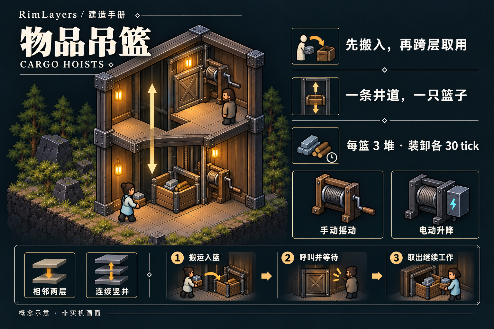
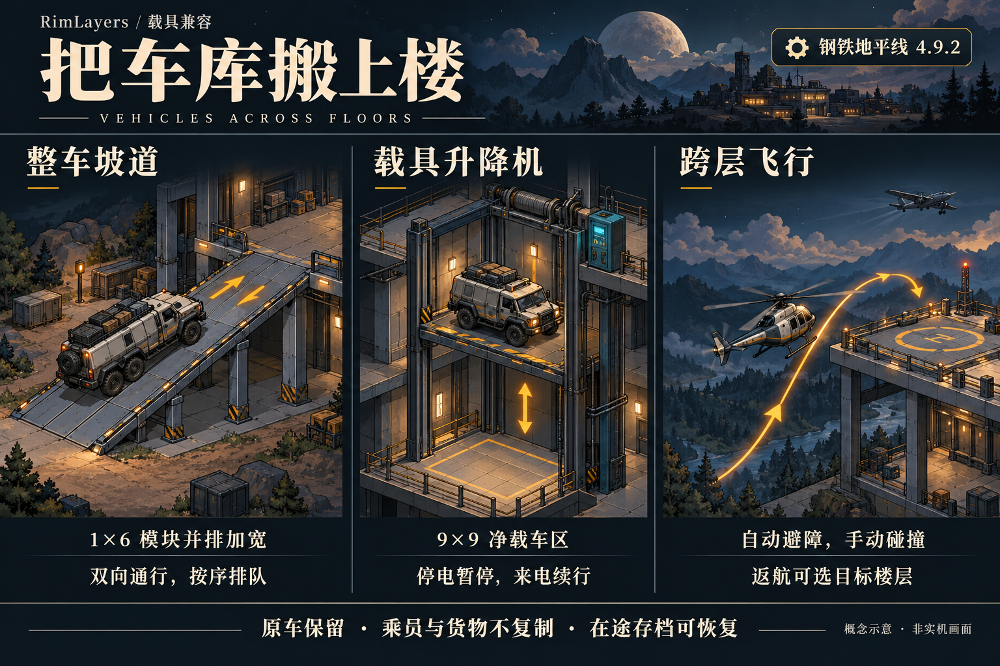
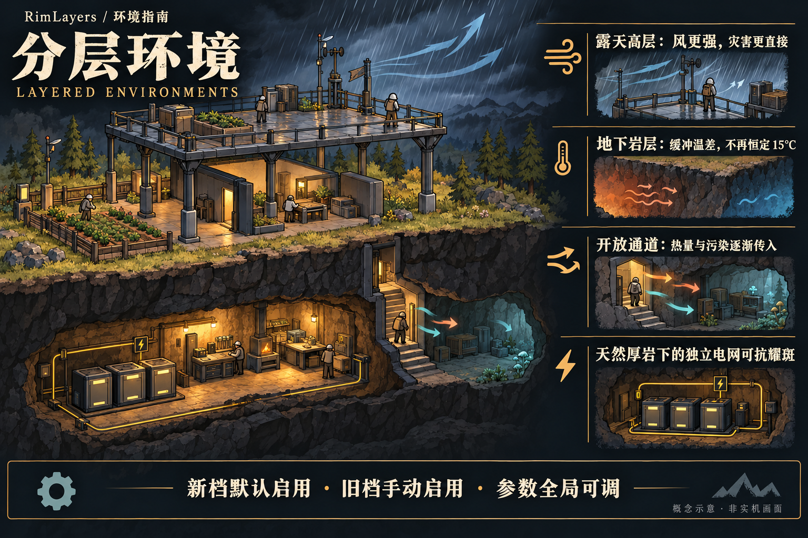
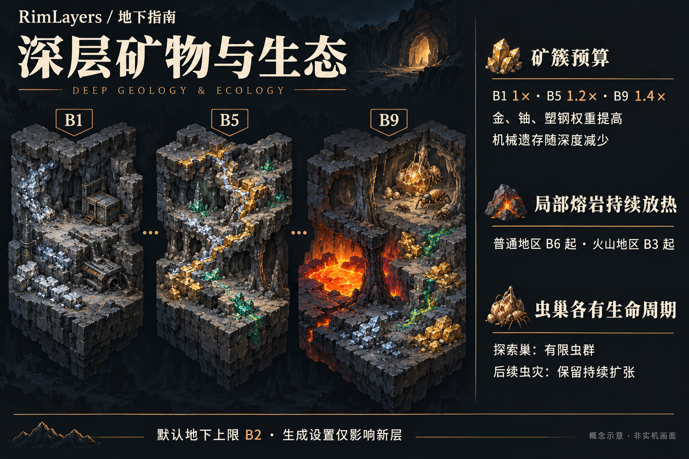

# RimLayers

[English](README.md) / 简体中文
## 向上建造，向下开拓

把卧室搬到工坊楼上，把矿道开到殖民地下方。**RimLayers 为 RimWorld 1.7 带来同一张地图内的多层殖民地**：地表与按需增建的地上、地下楼层。默认允许地上、地下各 2 层，可在设置中调整。殖民者沿真实连接通行，继续搬运、取料、生产和战斗。

**当前版本：0.1.5 开发候选 · 依赖：Harmony 3 · 语言：简体中文 / English**

[开始建造](#开始建造) · [建筑与楼板](#建筑与楼板) · [物品吊篮](#物品吊篮) · [分层环境](#分层环境与地下生态) · [载具通行](#载具也能跨层) · [安装与存档](#安装与存档) · [兼容与验证](#兼容与验证)

## 一座殖民地，多层空间

- **往上盖，而不是另开一张地图。** 用楼梯和电梯连接楼层，在下层屋顶上铺结构楼板，把工坊、仓库和居住区分层安排。
- **货物上楼，人不用跟着走。** 手动／电动物品吊篮让已有库存跨层取用，支持相邻两层和连续竖井；装入、升降和取出都需要时间。
- **山体也有纵深。** 厚顶岩上方生成天然岩石楼面与独立矿脉；从山侧平台进入，或让矿工先挖通楼梯出口。
- **往下挖，收益与风险一起增加。** 矿物按深度与地热分带，深处可能出现持续放热的熔岩；首次探索的有限虫巢与后续会扩张的普通虫灾各有生命周期。
- **高低差进入战斗。** 支持跨层射击、原版射位 AI、炮台、护盾、曲射与三维爆炸。楼板、屋顶和墙体会真正挡住弹道。
- **高层迎风，地下隔热。** 天气与灾害按实际暴露作用；开放通道传入热量和污染，关闭后残余污染仍会逐渐沉降。天然厚岩下的独立电网可抗太阳耀斑。
- **载具沿真实通道上楼。** 可选钢铁地平线兼容提供整车坡道、载具升降机与三维飞行；驾驶员、乘员、货物和损伤保留原对象。
- **有 Odyssey，还能造多层逆重飞船。** 多层甲板、乘员、货物与设施随同一艘船航行，普通平台与船体保持各自归属。

封面与下方卡片为 AI 生成的概念示意。游戏使用俯视切层显示；实机画面和各功能的运行记录见[兼容与验证](#兼容与验证)。

## 开始建造

### 先搭一间楼上的房间

1. **在下层完成屋顶。** 人工平台需要紧邻下层的有效人工屋顶或薄岩屋顶；先用墙或柱子把屋顶支撑好。
2. 在“结构”中建造 **向上楼梯**。完工时只追加需要的上一层，并建立最小落脚平台；新地图不会一开始就生成所有空层。
3. 按 **F8** 查看上层，选择 **结构楼板**，沿绿色可规划边界拖出蓝图。工人会从真实边缘逐步铺设，不必每建一圈重新下蓝图。
4. 在有效楼面上正常建房、放家具和下达工作。需要跨层供电时，在相邻层同一位置分别建造 **垂直电力端子**。
5. 想继续向上，在已有上层重复上述步骤。默认允许地表以上 2 层；需要更多楼层时，在“模组设置 → RimLayers → 楼层”中调整单图和全局额度。

**F7 向下、F8 向上**；右侧 `− / +` 和 `Alt + ↑ / ↓` 也可切层，可在“选项 → 按键”中重绑。切换查看层不搬动殖民者，也不重新分派工作。普通点选和建造作用于当前查看层；有屋顶的下层室内不会被透视揭开。

手动换层默认播放 **320 毫秒俯视升降与淡入**，界面保持静止。连续按键直接更新目标；点击地图下令或操作相机会立即结束过渡。可在“模组设置 → RimLayers → 显示”关闭“换层过渡动画”，恢复瞬切。选中对象定位与自动相机跳转仍即时完成。

人工楼板下的屋顶必须持续有效；移除支撑可能引发坍塌。厚顶岩上方的天然楼面走[山体开挖流程](Docs/MOUNTAINS.md)，不能当普通楼板拆除。

### 再开一条地下矿道

在地表合法基底上建造 **向下楼梯** 或 **向下单层电梯**。如果出口有岩石，框架会显示“等待竖向开采”：启用殖民者的采矿工作，先挖通真实岩体，再由建筑工完工。到 B1 后可在地下上限内继续开挖；挖矿进度、产物和矿脉状态随存档保留。

**冰盖和海冰整图禁挖。** 水、冰、熔岩、桥面、基架及悬空位置不能作为入口，装修地板不能改变基底资格。地上楼层、太空与原生独立地下 / Pocket 地图不适用这套向下开挖。详见[地下层指南](Docs/UNDERGROUND.md)。

## 建筑与楼板

便宜的日常通路先用楼梯；需要封闭连接和快速通行时用单层电梯；已有多层、需要贯通直达时再布置垂直电梯站。电梯不自动跨层并网，也不作为传气、换热或明火通道。

基础玩法提供 **6 种通行与供电建筑、7 种吊篮构件及 2 种楼板**；可选载具兼容另有专用坡道、升降机与甲板，见[载具通行](#载具也能跨层)。下方先介绍通行、供电与楼板，储物运输见[物品吊篮](#物品吊篮)。卡片展示默认设置的材料、工时、耗电与楼层范围；修改倍率或扩层上限后，以游戏内当前定义为准。

### 向上楼梯

无需电力和研究。禁止殖民者使用楼梯不会封闭通道；关闭落脚门才封闭该通道。未牵引的放牧动物不能自行使用楼梯，牵引时可以通过。楼梯本身不导电。

### 向下楼梯

从地表或 B1 向下开挖。出口未清理时材料留在框架中；拆掉入口不会删除已经生成的地下层，也不会刷新资源。

### 单层电梯

需要建造技能 6。通电通行耗时 25 tick，断电应急为 180 tick；与楼梯一样只追加所需的上一层，连接建立后可双向通行。

### 向下单层电梯

需要建造技能 6。挖掘限制与向下楼梯相同，通行耗时与单层电梯相同；成品安装也不会免费清除出口岩石。

### 垂直电梯站

需要建造技能 6。在**已有楼层**逐层建站，不自动生成楼层或整条井道。中间构件可关闭“本站停靠”，但不能拆掉贯通构件。通电耗时为 `30 + 45 × 层差` tick，应急为 `90 + 120 × 层差` tick；不模拟共享轿厢调度。

### 垂直电力端子

每层分别接入本层电网。关闭端子会同时切断竖向连接与该格本层输电；不要用楼梯或电梯代替它。

### 结构楼板

上面可以铺装修地板、摆放建筑。人工楼面的整个占地都要有合法支撑；屋顶的背景图像本身不是可走楼面。

### 飞船结构楼板 · Odyssey

用于**已有引擎船体的上甲板**，可叠加装修。要在二、三层起造船底，先建普通结构平台，再铺原版逆重飞船基架并安装引擎；普通楼板不会自动变成飞船甲板。

## 物品吊篮

**把钢铁存进一层吊篮，二层建筑工就能叫篮取料，不必亲自下楼。** 吊篮运送的是已经入篮的实物；篮中没有所需物品时，殖民者照常寻找其他来源，不会自动从远处采购装篮。

### 三步开始跨层存取

1. 在**已有楼层**的“家具”菜单选择 **相邻层吊篮** 或 **竖井吊篮**。相邻式可选手动／电动与向上／向下，主机完工时生成另一端；竖井式先建主机，再在紧邻层同坐标逐层建 **吊篮扩展站**。
2. 在任一端的“储存”页设置筛选和优先级，再让搬运工把物品放入；也可优先命令搬运。所有端口共享筛选和 **3 个原版堆栈**的容量，默认储存优先级为“优先”。
3. 做饭、制造、建筑供料和进食需要篮中物品时，殖民者到可达端口操作、等待、取出，再继续原任务。右键端口还可搬出、穿戴、装备或食用适用物品；“呼叫到本站”只叫篮，不补货。

| 组合 | 连接方式 | 默认建造材料 |
|---|---|---|
| 手动物品吊篮 | 相邻两层，向上／向下 | 木材 40＋钢铁 30，包含两端 |
| 电动物品吊篮 | 相邻两层，向上／向下 | 钢铁 90＋零部件 2，包含两端 |
| 手动竖井吊篮 | 同坐标连续多层 | 主机木材 60＋钢铁 60 |
| 电动竖井吊篮 | 同坐标连续多层 | 主机钢铁 140＋零部件 4 |

竖井每层扩展站另需钢铁 30，增加站点不增加容量。每个端口占 **1×1**，旁边须有操作位置；只连接已有且有合法楼面的楼层，不创建楼层、不清除岩石。吊篮不运人，也不连通空气、热量或电网。

**装入和取出各需 30 tick。** 跨越 d 层时，手动升降为 `180 × d` tick，请求者必须持续摇动；电动为 `30＋45 × d` tick，主机待机 30 W、运行 120 W，装卸仍由殖民者完成。篮子已在本站时没有升降耗时。手动需“复杂家具”研究，电动另需“电力”。

一条井道只有一只篮子，按先到先服务排队；存入预留容量，取出预留实际数量。手动中断保留机械位置，电动取消后完成当前行程；断电暂停升降，已停靠站点仍可装卸。检视栏显示位置、进度、排队及故障；拆主机前先卸空。

[完整吊篮指南](Docs/CARGO.md) · [任务闭环、存读档与飞船保全验证](Docs/CARGO-VALIDATION.md)

## 载具也能跨层

把货车驶上二层仓库，把直升机停到屋顶平台。可选兼容 **钢铁地平线（Steel Horizon）4.9.2**，正常启动自动识别，无需额外开关。加载顺序为 **Harmony → 钢铁地平线 → RimLayers**，车型包按自身依赖排序。

### 货车沿真实通道上楼

- **坡道按车宽并排建。** 每模块宽 1 格、长 6 格，连接相邻一层；同起点、同方向的模块并排加宽，容纳整车。先准备有支撑的出口平台并清理净空；多层经平台转接，不纵向拼成长坡，也不在坡面掉头。
- **升降机一次运一辆停稳的车。** 各层同坐标的 **9×9 净载车站点**组成完整竖井，各站接电。车辆完全进入并停稳后运输；相向车辆按通道预约排队。停电暂停，恢复供电续行，不采用人员电梯的断电应急通行。
- **自动任务与 WASD 共用整车检查。** 自动驾驶沿框架自己的层内路径接续最终目标，手动驾驶可自然通过坡道，升降机使用“前往楼层”。自动运输不强制切镜头，手动跨层跟随所控车辆。

站点损坏或取消时优先返回合法出发站；没有合法出口就保留原车。先重建站点、清空整车占地，再从楼层面板恢复。运输保留车辆、乘员、货物、燃料和既有伤损；坡道、轿厢及飞行中的行程可保存重载。

### 飞机按高度跨层，返航选定楼层

- **沿用原生驾驶与起降。** 每层相隔 **3 米**，直升机、VTOL 和固定翼随爬升、下降自然跨层；高于最高已建楼层时不会自动扩层。固定翼保留前向动力学，需要足够的进近和转弯空间，不能按直升机悬停。
- **整机检查三维净空。** 自动航路绕障，手动失误、动态障碍或失去动力可能造成实际伤损与坠毁；完整楼板、屋顶和墙体仍会挡住机体。
- **可从上层离图，并指定楼层返航。** 选点与实际抵达都会复查整机落点和进出空域。落点失效时，原机留在框架持有状态，从世界载具命令或楼层面板“等待降落的载具”重新选点，不会静默改降地表。

**已实测车型：** 地面 Bang Bus、BigBread；直升机 Mosquito、VTOL Toad、固定翼 Smuggler。VVE、VVE Tier 3 和 Technical Vehicles 的加载范围与各场景证据见[完整载具指南与实车验证](Docs/VEHICLES-IMPLEMENTATION.md)；其他旧版车型及专有组件需逐一确认。

只启用**一套**载具框架。未来原版 Vehicle Framework 1.7 仍需按实际接口适配验证，不与钢铁地平线同时加载，也不承诺两套提供者的存档直接互换。未安装框架时，基础楼层照常工作，不显示载具专用设施。本次兼容不扩展水面航行、CE 跨层战斗或全面跨层武器弹道。

## 多层飞船怎么用

需要 **Odyssey**。引擎可以位于任意甲板，驾驶台、推进器、延展器和油箱可跨层关联；各层基架共同消耗承载量，原版研究、燃料、冷却和设施上限继续生效。

- 可选择已有上层作为落点，船底落在选定层，引擎保留相对高度；**载荷最多跨 6 层甲板，最高点不能超过海拔 +9，新增层还须通过配额检查**。高层落点仍需合法下层屋顶支撑，起降通道必须净空，地下不能起降。
- 船底可以覆盖普通停机坪，离开后还原平台及装修。相邻的船保持独立身份，普通建筑不因贴着船就自动归船。
- **跨越起飞移动边界的建筑会在确认后销毁**，其真实容器内容与框架材料留岸；跨界区域应先拆分。
- 旧通用甲板需在引擎上使用“转换旧甲板”预览并确认。原版逆重锚政策不变，**无锚强行起飞仍会放弃原地图**。

详细操作见[飞船与普通楼层共存](Docs/SHIP-COLONY-COEXISTENCE.md)及[多层飞船与电梯](Docs/DECKS-AND-ELEVATORS.md)。

## 战斗与环境要记住的事

选中射手并进入原版攻击模式，再切到目标楼层。楼板、屋顶和墙会影响射线；能看见下层背景不代表能射穿它。人物与炮台使用跨层射击解，普通近战仍限同层。迫击炮即使攻击同层目标，也会检查上方空间。具体射程、掩体和灾害规则见[三维战斗指南](Docs/COMBAT-3D.md)。

跳跃背包和蝗虫装甲可通过原版“跳跃”命令跨层：进入选点后切到目标层。可沿平台边缘上下跳，但不能穿过天花板、楼板、飞船甲板或地表进入地下；高度差计入射程。详见[跳跃背包指南](Docs/JUMP-PACK.md)与[游戏验收](Docs/JUMP-VALIDATION.md)。

完整楼板阻气，开放井口与楼梯通道按各自授权传气、换热、传声和蔓延火焰。天空暴露按整列楼板与屋顶判断；人工灯光当前限同层。地下边缘不是世界出口，天空投送不会落到地下。

## 分层环境与地下生态

把需要稳定温度的工坊搬入岩层，把迎风平台留给露天设施；竖井既是便利通路，也会把热量和污染带入地下。

**新档默认启用；旧档在“模组设置 → RimLayers → 环境与生态”手动启用。** 数值全局共用，启用状态随存档保存。运行参数在下次相应更新生效；矿物、熔岩与初始虫巢的生成参数只影响新层，不重刷已探索资源。

### 高层迎风，地下缓冲温差

- **地下不再恒定 15°C。** 新层岩温以当地年均温为基础，默认每深一层增加 0.25°C，之后缓慢追随外界变化。机器、火灾和熔岩仍会使洞室积热，需要安排散热与通风。
- **遮蔽按真实位置判断。** 楼板与屋顶挡住直接降水，雷击优先接触同列最高暴露承托面；龙卷风风柱作用于地上暴露区域，地下免受直接风伤。
- **关门停止输入，残余不会立刻清空。** 雾、毒尘与火山灰等按房间浓度传播和沉降；移动看当前位置，射击精度与浓雾射程看三维射线经过的区域。洪水与熔岩流只能沿本层或开放液体通道向下传播。
- **抗耀斑要隔离整张电网。** 默认只有所有接通节点都受天然厚岩屏蔽的电网可运行；接入一个暴露节点，全网仍受干扰。断开并完成电网重建后恢复屏蔽。人工楼板不能代替厚岩，EMP 与其他停电仍照常生效。

### 深挖获得不同资源，也要应对地热与虫巢

- **矿带有深度倾向。** 金、铀、塑钢的相对生成权重随深度上升，机械遗存减少；相邻层矿带可偏移、分叉，不复制上一层矿格。深度加成作用于矿簇预算，每格原生产量不变，稀有矿不设每层保底。
- **熔岩是局部热源。** 默认普通地区 B6、火山地区 B3 起生成，带冷却岩岸和承顶岩柱；深熔岩不可通行，浅熔岩会烧伤并可冷却。地热富集使用同层已有矿物预算。
- **探索巢与后续虫灾分开。** 初始探索巢有有限虫群，不持续产虫或扩巢；后续普通虫灾保留原生频率、威胁点数与全图巢数上限。低温、高温和照明影响选址，活虫仍可沿真实通道追击。

**默认地下上限仍为 B2。** 想继续深挖，先在“楼层”页提高地下上限，并留足全局额度；已生成层不会因修改生成参数而补矿或补熔岩。

[完整环境、矿物、熔岩与虫灾说明](Docs/ENVIRONMENT-IMPLEMENTATION.md) · [B9 实机画面](Docs/Images/Environment/magma-odyssey.png) · [固定种子矿物统计](Docs/Validation/Environment/mineral-distribution-alldlc.json)

## 设置与异常恢复

从“模组设置 → RimLayers”打开 **显示、楼层、玩法、地下生成、兼容与恢复、环境与生态** 六页。设置全局共用；界面标明即时生效、重启生效和仅新生成层生效的项目。

单图上、下限默认各 2，全局额外楼层默认 20；例如上、下限各 5 可容纳地表加上下共 11 层。降低上限不删除旧层，也不阻断已有通行。空层仍占配额，只有地图真正移除才释放。

遇到异常空域实体时，默认先寻找下落承托，再安全复位；没有合法落点就暂存原对象。打开“兼容与恢复 → 待恢复列表”定位、重试或指定合法落点。兼容恢复不附加伤害，正常坍塌仍按每层 8 点钝伤结算。来源地图已移除时，恢复到其他地图需要明确确认。

[完整设置与恢复说明 / English guide](Docs/SETTINGS.md)。超出旧版 ±2 范围的楼层存档不能回退旧版 DLL 读取。

## 安装与存档

1. 使用 **RimWorld 1.7**。加载顺序为 **Harmony → RimLayers**，使用匹配 1.7 的 **Harmony 3**；基础楼层玩法不要求 DLC，飞船功能需要 Odyssey。 启用载具兼容时，将载具框架排在 RimLayers 之前。
2. 本地安装时将完整 mod 文件夹放到 `RimWorld/Mods/RimLayers/`，在模组列表启用后重启游戏。当前核对基准为 **1.7.4984 rev1242 / Waylith / .NET 10**。
3. 旧地图可在首次建成连接器后按需扩层，不会仅因读档就自动增加楼层。**先备份原存档，首次使用后另存新槽。**
4. **使用了楼层的存档持续依赖 RimLayers，不能安全移除。** 更新 DLL 后必须重启游戏，Def 热重载不能替代重启。

建议地表尺寸不超过 **250 × 250**。首次追加楼层会暂停片刻，地图越大耗时越高；长期大型殖民地与大型战斗的性能仍需更多验证。

## 兼容与验证

- **不要同时启用 IsoRim ProjectZ 或 Baal.SecondFloor。** 它们与本 mod 的楼层实现冲突，元数据已声明互斥。
- **可选兼容 Vanilla Gravship Expanded Chapter 1 / 2。** 装有 VGE 时将 RimLayers 排在两章之后；保留 VGE 单活动引擎、燃料管网及干扰规则。不装 VGE 仍支持原生多船。范围与验证见 [VGE 兼容](Docs/VGE-COMPATIBILITY.md)。
- **钢铁地平线 4.9.2 的可选载具兼容已实车验证。** 使用范围与框架限制见[载具通行](#载具也能跨层)。
- **CE、其他飞船框架、非投射物特殊 Verb 及其他自定义战斗 / 地质框架需要单独适配。**
- 原生独立地下地图与 PocketMap 不自动扩层。普通 NPC / 太空地图也不自动扩层；合法入站飞船准备和主动建成连接器按各自规则处理。
- 已有 Core 与全五 DLC 的独立场景记录，覆盖跨层工作、保存重载、结构、山体、地下、战斗及原生飞船；具体组合和结果以各验收文档为准。

实机画面与运行证据：

- [分层气候、耀斑隔离、矿物批次、熔岩及虫灾](Docs/ENVIRONMENT-IMPLEMENTATION.md)
- [载具坡道、电梯、飞行与恢复](Docs/VEHICLES-IMPLEMENTATION.md)
- [地下 B1/B2、竖向开采与存档](Docs/UNDERGROUND-VALIDATION.md)
- [山体入口、独立矿脉与旧层迁移](Docs/MOUNTAINS.md)
- [射击、炮台、爆炸与跨层灾害](Docs/COMBAT-3D.md) · [真实袭击与投掷](Docs/RAID-COMBAT-VALIDATION.md)
- [吊篮存取、排队、重启读档与飞船货物保全](Docs/CARGO-VALIDATION.md)
- [飞船停靠高度与普通平台共存](Docs/SHIP-COLONY-VALIDATION.md)
- [换层过渡、输入回归与性能记录](Docs/TRANSITION-VALIDATION.md)
- [俯视切层的实际显示](Docs/DISPLAY-VALIDATION.md) · [跨层连续施工与旧档](Docs/USABILITY-VALIDATION.md)

### 报告问题

请附上游戏版本、RimLayers 版本、启用的 mod 列表、复现步骤，以及问题发生后的 `Player.log`。跨层问题请说明出发层、目标层和连接器类型；存档问题请保留出问题前的存档。

Windows 日志位置：`%USERPROFILE%/AppData/LocalLow/Ludeon Studios/RimWorld by Ludeon Studios/Logs/Player.log`。

## 开发、素材与许可

- 包标识：`rimlayers.core`；程序集：`RimLayers`；编译目标：`net10.0`。
- [开发记录、构建命令与历史验证入口](Docs/DEVELOPMENT.md) · [设计计划](Docs/PLAN.md) · [实施记录](Docs/WORK-LOG.md)
- [封面、卡片与完整生图提示词](Docs/RELEASE-ART.md)
- [第三方许可声明](ThirdPartyNotices.md)：部分生成适配基于 MIT ProjectZ，保留其许可和归属；这不构成对 ProjectZ 的运行依赖。

